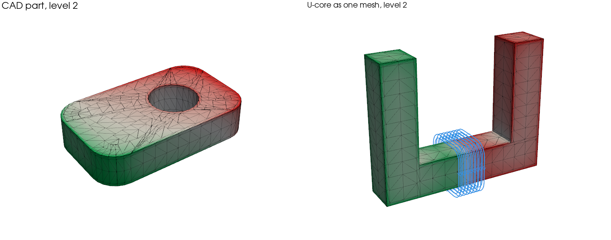

# Face charge: linear parts without a volume mesh

`apply_demag` fills every part with cells. For a part whose susceptibility is
uniform and isotropic, such as soft iron in its linear range or a magnet with a
small susceptibility, that is more than the physics needs: such a part carries
no magnetic charge inside, and its whole response is a charge on its surface.
`apply_face_charge` solves only that charge, on panels over the faces, without a
volume mesh.

```python
import magpylib as magpy

from magpylib_material_response.face_charge import apply_face_charge

plate = magpy.magnet.Cuboid(
    dimension=(0.01, 0.01, 0.004),
    polarization=(0, 0, 0),
)
plate.susceptibility = 1000
magnet = magpy.magnet.Cuboid(
    dimension=(0.004, 0.004, 0.003),
    position=(0, 0, 0.0045),
    polarization=(0, 0, 1.2),
)

solved = apply_face_charge(magpy.Collection(plate, magnet))
B = solved.getB((0, 0, 0.0035))
```

The result is a copy of the collection in which the plate is a `ChargeSheet`, an
ordinary magpylib source: `getB`, observer paths, `show()` and `to_json` work as
for any other; magpylib-studio does not draw it yet. A cuboid whose
susceptibility is exactly 0 is not solved and stays as it was. `show()` colours
the solved charge in the magnet colours, positive charge being a north pole;
`style.mesh.grid.show` draws the panels. The colour is full at the charge that
95 % of the surface stays below, not at the singular peak in a corner, and the
parts solved together share it, so their colours compare.


## When it fits

- **What it solves:** cuboids, alone or touching, placed and turned freely,
  cylinders, cylinder segments and spheres (below), and closed triangle meshes
  such as CAD exports (below), each with a uniform isotropic susceptibility and
  a uniform remanence, driven by any other magpylib sources and by the applied
  field `H_ext`.
- **How well:** on the six documented examples it lands within each reference's
  own uncertainty, 0.64 % at worst, where `apply_demag` at the documented
  settings is off by up to 23 %. On soft iron it is 20 to 40 times more accurate
  than `apply_demag` in the same time, and it reaches 1 % faster than finite
  elements on every validation case both reach it on, 3 to 104 times (below).
- **Where it is slower:** a few weak magnets alone (`apply_demag` reaches the
  same accuracy faster), many bodies (one dense coupled system: 100 small cubes
  take 7,200 unknowns at level 1 and four times as many at level 2), thin sheets
  (panels sized to the thickness across the whole sheet). Those small panels
  also make a thin part converge early: take `level=2`. A 0.5 mm plate under a
  magnet is within 0.03 % of level 3 there, in 0.5 s instead of 1.7. A solve
  that would need more than `max_unknowns`, 20,000 by default, a 3.2 GB system
  and 4.8 GB while it is solved, is refused before it is assembled, a triangle
  mesh's from a count of its cells before they are cut; without a `level`, the
  highest level up to 3 that fits is taken instead, with a warning. A thin wall
  that shields a field, such as a tube around a magnet, needs `refine=1`
  (below).
- **Magnets on a part:** a magnet without susceptibility resting on a solved
  part, or close above it, converges like the rest when it is a cuboid aligned
  with the part: the mesh follows its footprint and the field near it is
  integrated finely. A disc magnet, or a cuboid turned against the part, has a
  footprint the panels cannot follow; `apply_face_charge` warns, and a disc on a
  soft cube stays 3 to 4 % off near it from level 4 on.
- **Fields outside the parts:** inside a solved part, `getB` gives μ0 H without
  the part's own magnetization, and `getJ` gives 0. For B inside a part, such as
  the flux in a yoke, mesh it and use `apply_demag`.
- **What it leaves to `apply_demag`:** saturation, an anisotropic susceptibility
  and one varying inside a part, all of which bring back charge inside the part,
  and objects moving along paths. `apply_face_charge` raises for these.

## Triangle meshes and CAD exports

A part exported from CAD as a closed triangle mesh, a magpylib `TriangularMesh`,
is solved on its surface triangles, with no tetrahedra, as is a `Tetrahedron`.
Each triangle carries a charge linear across it, and the mesh is graded toward
its sharp edges, where neighbouring triangles turn by more than 20°: layers over
half the part's thickness, its smallest width in any direction, as the cuboid
panels' layers. The flat faces are merged first, so that the export's long
diagonals do not cross the layers; a flat face with vertices inside it, as an
FEM surface mesh has, is rebuilt from its outline alone, so it costs the same
however it was cut.

```python
part = magpy.magnet.TriangularMesh.from_pyvista(
    polydata=cad_surface,  # a closed pyvista surface, in metres
    polarization=(0, 0, 0),
)
part.susceptibility = 1000
solved = apply_face_charge(magpy.Collection(part, coil), level=2)
```



- **How well:** the validation's CAD part, a plate with filleted corners and a
  round hole, reaches 0.70 % of its finite-element reference at level 1 in 0.20
  s, 0.16 % at level 2 in 0.50 s, and the reference's own 0.07 % from level 3,
  in 1.0 s. The U-core as one closed mesh is within its reference's 0.25 % from
  level 2.
- **Cuboids stay cuboids:** a box given as triangles needs twice the unknowns of
  its rectangle panels for the same accuracy, and the U-core as three cuboids
  reaches its reference's accuracy 5 times faster than as one mesh. Give a part
  as cuboids where it is made of them: on the nine validation cases both solve,
  rectangle panels reach 1 % as fast to 15 times faster, and a thin sheet needs
  too many triangles to solve at all.


- **Touching parts:** faces of two parts in one plane couple exactly, whatever
  their panels, and a part is graded toward the outline of whatever touches it,
  a turned footprint included, or comes within 1 % of its size. Parts of one
  material that touch are solved as one: the faces they share carry no charge,
  so a short bar between two wide ones is 0.83 % off the same solid as one mesh
  at level 2, where both sides' charges, left to cancel, were 16 % off. A gap
  far below the panels moves the field by its own effect: four pieces 1 µm from
  a plate's side 0.13 %, as one piece, where they were 170 % off. A cube given
  as triangles with a soft cuboid against one of its faces matches two cuboids
  to 4e-5 at level 4. Turned against each other, two cuboids converge
  erratically, as rectangle panels can only follow their own axes; with one of
  them as a triangle mesh the solve converges steadily. A magnet that is not a
  cuboid touching a triangle mesh warns, as its footprint is not graded toward.
- **Limits:** the mesh must be closed. A curved face exported as many narrow
  facets keeps a charge per facet, so a fine export costs unknowns; a cylinder
  or a sphere is better given as itself (next section).

## Cylinders, cylinder segments and spheres

A curved face is cut into flat facets, `12 (level + 1)` per turn (48 at level
3), widened so that the part keeps its true volume, and then meshed as a
triangle mesh is. The widening matters more than the facets' number: on a soft
cylinder at level 3, 24 widened facets are 0.02 % off 50 mm away, 96 facets
without it 0.16 %. A sphere is a geodesic polyhedron that gets finer with the
level, as it has no edge to grade toward. Against the validation's FEM
references and the exact field of a sphere, on one M4 Pro:

| Part                                   | Error, time                                                | `apply_demag` at best |
| -------------------------------------- | ---------------------------------------------------------- | --------------------- |
| Soft cylinder, 1 mm off its surface    | 0.41 % in 0.12 s at level 2, 0.12 % in 0.3 s at level 3    | 2.4 %                 |
| Soft sphere, 1 mm off its surface      | 0.20 % in 0.09 s at level 1, 0.12 % in 0.4 s at level 3    |                       |
| Thin ring beside a magnet, inside it   | 1.3 % in 1.8 s at level 3, 0.85 % in 4.8 s with `refine=1` | 395 %                 |
| Steel tube around a magnet, outside it | 5.6 % in 8.9 s at level 3, 1.0 % in 21 s with `refine=1`   | 41 %                  |
| Soft rod 1 mm across, 20 mm long       | 0.07 % in 2.7 s at level 2, the default here               |                       |

- **Thin walls that shield** converge slowly with the level: outside the tube
  the field is what is left of the magnet's after the tube takes most of it, and
  the tube's cells are sized to its width, not its wall. `refine=1` splits the
  triangles where the charge jumps, at the rims and near the magnet, and brings
  it within 1 %.
- **Slender parts** are converged well below level 3: the rod is within 0.4 % at
  level 1. Without a `level`, the highest level that fits `max_unknowns` is
  taken.

## Against finite elements

The repository's validation suite (`validation/`) solves 12 of its cases with
face charge, at levels 1 to 5, against stored finite-element references. The
time each method needs to bring the worst group of sensors within 1 % and 0.1 %
of the reference, solve and `getB` together, one run each on an Apple M4 Pro;
finite elements are `fem_solve` at orders 2 to 5:

| Case                         | Face charge to 1 % | FEM to 1 % | Face charge to 0.1 % | FEM to 0.1 % |
| ---------------------------- | -----------------: | ---------: | -------------------: | -----------: |
| Three cuboids, turned        |             0.05 s |      2.6 s |               0.05 s |        2.6 s |
| Magnet beside a soft cube    |             0.02 s |      2.3 s |               0.10 s |        2.3 s |
| U-core driven by a coil      |             0.13 s |      8.5 s |                  – ¹ |          – ¹ |
| Flux concentrator            |             0.04 s |     0.83 s |               0.05 s |        3.3 s |
| Halbach array on back iron   |             0.06 s |      1.5 s |               0.06 s |        6.3 s |
| Iron cube in 10 mT           |             0.04 s |     0.52 s |               0.04 s |        2.0 s |
| Magnet on a soft plate       |             0.09 s |      3.1 s |               0.40 s |        5.0 s |
| Magnet on a plate, sides off |             0.09 s |      2.8 s |               0.40 s |        2.8 s |
| Thin shielding sheet         |             0.28 s |      2.7 s |               0.91 s |         10 s |
| CAD part, a triangle mesh    |             0.20 s |       11 s |                1.0 s |         21 s |
| Cuboids of many sizes        |              2.9 s |      8.3 s |                  – ² |          – ² |
| 100 small cubes              |                – ³ |        – ² |                    – |            – |

¹ The reference, from an independent FEM, is good to 0.25 %. ² The references
are good to 0.2 % for the cuboids of many sizes and 1.5 % for the 100 cubes. ³
1.8 % at level 2, in 27 s and 11 GB, with `max_unknowns` raised to its 28,800
unknowns.

Face charge reaches 1 % faster than finite elements on all eleven cases both
reach it on, 13 to 104 times faster on nine. Finite elements come closest where
fields close to a surface need fine panels (the plate with its sides off, 7
times at 0.1 %), on the thin sheet (10 times) and where many bodies form one
large dense system (the cuboids of many sizes, 3 times).

## How accurate a solve is

`level` sets the panels in each graded layer toward a face's edges. Fields far
from the parts converge at low levels; fields within a panel's size of a surface
need higher ones.

Each solved sheet reports its `jump_indicator`: the largest jump of the charge
between neighbouring panels, weighted by panel size. The true charge is
continuous across a flat face, so the jump is discretization error, read off the
solve for free. For the plate under the magnet the worst error of B 0.25 mm
above the plate is 1 to 3 times it.

`refine` uses the same jumps: each round splits the panels where they are
largest, a cuboid's panel in two along both axes and a triangle into four, and
solves again. For the plate, `refine=2` from level 3 (2,688 unknowns, under 2 s)
puts B 0.25 mm above the plate within 0.04 %, where uniform panels need 10,350
unknowns and 20 s for 0.13 %. Outside the steel tube, one round from level 3
brings 5.6 % down to 1.0 %.

## Whether saturation matters

A sheet's `mean_polarization` is the average polarization of the part it
encloses. While it stays below the knee of the material's B–H curve, the linear
solve holds. Above it, saturation takes over: mesh the part and use
`apply_demag` with a B–H iteration.

## How it works

With `M = M0 + chi H` and `div B = 0`, a uniform isotropic `chi` gives
`div M = 0` inside, so the part is fully described by the surface charge
`sigma = M.n`, which solves

$$
(1/\chi + 1/2)\,\sigma - K'\sigma = H_{ext}\cdot n + M_0\cdot n / \chi ,
$$

with `K'` the adjoint double-layer operator of the surface, which depends on the
shape only. The faces are cut into panels graded toward the edges, where a soft
part's charge is singular. Each panel carries a charge linear across it, with
fields in closed form, and the equation is solved in its Galerkin form. Touching
parts are coupled exactly, even when their panels do not match. From 2,000
unknowns on, the dense system is factorized in single precision and refined to
double's accuracy, three times faster. Assembly and fields run on
`magpy.defaults.threads` threads where magpylib has that setting, otherwise on
the CPUs the process may use, up to 8. On a cube the method reproduces the
polarizability of Helsing and Perfekt (2013) from below, as a Galerkin method
should: 4.5e-4 off at level 4.
