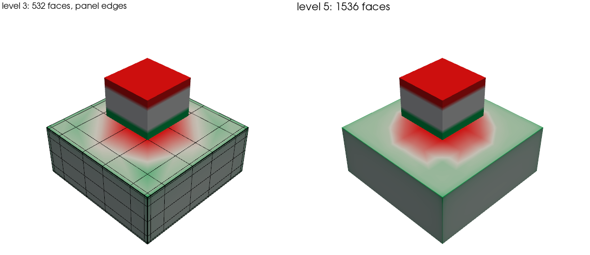

# Face charge: linear parts without a volume mesh

`apply_demag` fills every part with cells. For a part whose susceptibility is
uniform and isotropic, such as soft iron in its linear range or a magnet with a
small susceptibility, that is more than the physics needs: such a part carries
no magnetic charge inside, and its whole response is a charge on its surface.
`apply_face_charge` solves only that charge, on panels over the faces, without a
volume mesh.

```python
import magpylib as magpy

from magpylib_material_response.face_charge import apply_face_charge

plate = magpy.magnet.Cuboid(
    dimension=(0.01, 0.01, 0.004),
    polarization=(0, 0, 0),
)
plate.susceptibility = 1000
magnet = magpy.magnet.Cuboid(
    dimension=(0.004, 0.004, 0.003),
    position=(0, 0, 0.0045),
    polarization=(0, 0, 1.2),
)

solved = apply_face_charge(magpy.Collection(plate, magnet))
B = solved.getB((0, 0, 0.0035))
```

The result is a copy of the collection in which the plate is a `ChargeSheet`, an
ordinary magpylib source: `getB`, observer paths, `show()` and `to_json` work as
for any other; magpylib-studio does not draw it yet. A cuboid whose
susceptibility is exactly 0 is not solved and stays as it was. `show()` colours
the solved charge in the magnet colours, positive charge being a north pole;
`style.mesh.grid.show` draws the panels. The colour is full at the charge that
95 % of the surface stays below, not at the singular peak in a corner, and the
parts solved together share it, so their colours compare.



## When it fits

- **What it solves:** cuboids, alone or touching, placed and turned freely, each
  with a uniform isotropic susceptibility and a uniform remanence, driven by any
  other magpylib sources and by the applied field `H_ext`.
- **How well:** on the six documented examples it lands within each reference's
  own uncertainty, 0.64 % at worst, where `apply_demag` at the documented
  settings is off by up to 23 %. On soft iron it is 20 to 40 times more accurate
  than `apply_demag` in the same time, and it reaches 1 % faster than finite
  elements on nine of 11 validation cases, up to 34 times (below).
- **Where it is slower:** a few weak magnets alone (`apply_demag` reaches the
  same accuracy faster), many bodies (one dense coupled system: 100 small cubes
  take 7,200 unknowns at level 1 and four times as many at level 2), thin sheets
  (panels sized to the thickness across the whole sheet), and two solved parts a
  small gap apart, as the mesh is graded toward touching parts only. A solve
  that would need more than `max_unknowns`, 20,000 by default, a 3.2 GB system,
  is refused before it is assembled.
- **Magnets on a part:** a magnet without susceptibility resting on a solved
  part, or close above it, converges like the rest when it is a cuboid aligned
  with the part: the mesh follows its footprint and the field near it is
  integrated finely. A disc magnet, or a cuboid turned against the part, has a
  footprint the panels cannot follow; `apply_face_charge` warns, and a disc on a
  soft cube stays 3 to 4 % off near it from level 4 on.
- **Fields outside the parts:** inside a solved part, `getB` gives μ0 H without
  the part's own magnetization, and `getJ` gives 0. For B inside a part, such as
  the flux in a yoke, mesh it and use `apply_demag`.
- **What it leaves to `apply_demag`:** other shapes, saturation, an anisotropic
  susceptibility and one varying inside a part, all of which bring back charge
  inside the part, and objects moving along paths. `apply_face_charge` raises
  for these.

## Against finite elements

The repository's validation suite (`validation/`) solves 11 of its cases with
face charge, at levels 1 to 5, against stored finite-element references. The
time each method needs to bring the worst group of sensors within 1 % and 0.1 %
of the reference, solve and `getB` together, one run each on an Apple M4 Pro;
finite elements are `fem_solve` at orders 2 to 5:

| Case                         | Face charge to 1 % | FEM to 1 % | Face charge to 0.1 % | FEM to 0.1 % |
| ---------------------------- | -----------------: | ---------: | -------------------: | -----------: |
| Three cuboids, turned        |             0.17 s |      2.6 s |               0.17 s |        2.6 s |
| Magnet beside a soft cube    |             0.12 s |      2.3 s |               0.45 s |        2.3 s |
| U-core driven by a coil      |             0.25 s |      8.5 s |                  – ¹ |          – ¹ |
| Flux concentrator            |             0.11 s |     0.83 s |               0.36 s |        3.3 s |
| Halbach array on back iron   |             0.27 s |      1.5 s |               0.27 s |        6.3 s |
| Iron cube in 10 mT           |             0.11 s |     0.52 s |               0.27 s |        2.0 s |
| Magnet on a soft plate       |             0.32 s |      3.1 s |                3.4 s |        5.0 s |
| Magnet on a plate, sides off |             0.32 s |      2.8 s |                3.4 s |        2.8 s |
| Thin shielding sheet         |              2.2 s |      2.7 s |                7.6 s |         10 s |
| Cuboids of many sizes        |               25 s |      8.3 s |                  – ² |          – ² |
| 100 small cubes              |                – ³ |        – ² |                    – |            – |

¹ The reference, from an independent FEM, is good to 0.25 %. ² The references
are good to 0.2 % for the cuboids of many sizes and 1.5 % for the 100 cubes. ³
1.8 % at level 2, in three minutes and 6.6 GB, with `max_unknowns` raised to its
28,800 unknowns.

Face charge reaches 1 % faster than finite elements on nine of these cases, 5 to
34 times faster on seven. Finite elements catch up where fields close to a
surface need fine panels (the plate with its sides off, at 0.1 %) and where many
bodies form one large dense system.

## How accurate a solve is

`level` sets the panels in each graded layer toward a face's edges. Fields far
from the parts converge at low levels; fields within a panel's size of a surface
need higher ones.

Each solved sheet reports its `jump_indicator`: the largest jump of the charge
between neighbouring panels, weighted by panel size. The true charge is
continuous across a flat face, so the jump is discretization error, read off the
solve for free. For the plate under the magnet the worst error of B 0.25 mm
above the plate is 1 to 3 times it.

`refine` uses the same jumps: each round splits the panels where they are
largest and solves again. For the plate, `refine=2` from level 3 (2,688
unknowns, under 2 s) puts B 0.25 mm above the plate within 0.04 %, where uniform
panels need 10,350 unknowns and 20 s for 0.13 %.

## Whether saturation matters

A sheet's `mean_polarization` is the average polarization of the part it
encloses. While it stays below the knee of the material's B–H curve, the linear
solve holds. Above it, saturation takes over: mesh the part and use
`apply_demag` with a B–H iteration.

## How it works

With `M = M0 + chi H` and `div B = 0`, a uniform isotropic `chi` gives
`div M = 0` inside, so the part is fully described by the surface charge
`sigma = M.n`, which solves

$$
(1/\chi + 1/2)\,\sigma - K'\sigma = H_{ext}\cdot n + M_0\cdot n / \chi ,
$$

with `K'` the adjoint double-layer operator of the surface, which depends on the
shape only. The faces are cut into panels graded toward the edges, where a soft
part's charge is singular. Each panel carries a charge linear across it, with
fields in closed form, and the equation is solved in its Galerkin form. Touching
parts are coupled exactly, even when their panels do not match. On a cube the
method reproduces the polarizability of Helsing and Perfekt (2013) from below,
as a Galerkin method should: 4.5e-4 off at level 4.
