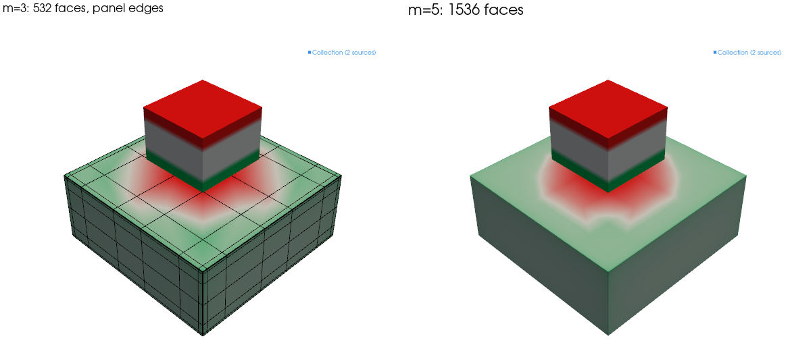
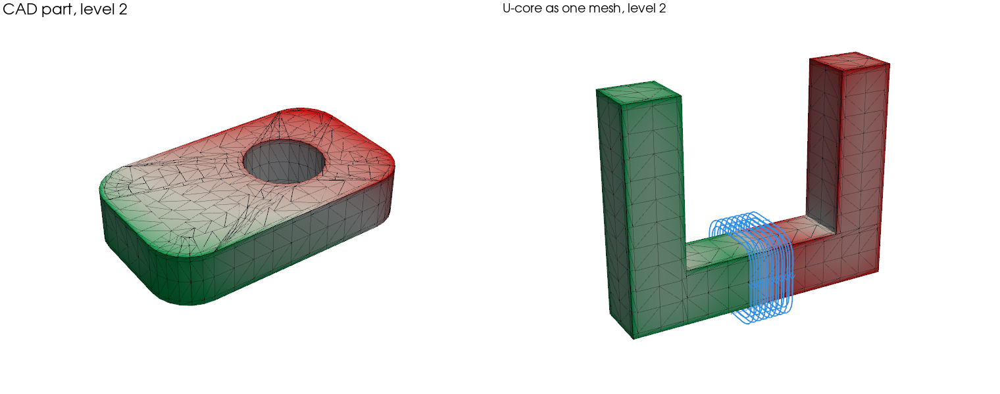

# Face charge

A soft part in its linear range, such as iron below saturation, has a uniform,
isotropic susceptibility. Such a part carries no magnetic charge inside: its
whole response is a charge on its surface. `solve_face_charge` solves only that
charge, on panels over the faces, with no volume mesh to build. It is the
default solver ([Choosing a solver](choosing.md)).

This page answers how to use it well. How do I solve a model and read it? What
can it take? How fine must the panels be? What changes when parts touch or
nearly touch? How does it take CAD meshes and curved parts? Where does it cost
more? And how does it compare with finite elements? The method itself is in
[Inside face charge](../inside/face_charge.md).

## Solve and read

```python
import magpylib as magpy

from magpylib_material_response import solve_face_charge

plate = magpy.magnet.Cuboid(dimension=(0.01, 0.01, 0.004), polarization=(0, 0, 0))
plate.susceptibility = 1000
magnet = magpy.magnet.Cuboid(
    dimension=(0.004, 0.004, 0.003), position=(0, 0, 0.0045), polarization=(0, 0, 1.2)
)

solved = solve_face_charge(magpy.Collection(plate, magnet))
B = solved.getB((0, 0, 0.0035))
```

The result is a copy of the collection in which the plate is a `ChargeSheet`, an
ordinary Magpylib source: `getB`, `show()` and `to_json` work as for any other,
and magpylib-studio draws it beside field lines. A magnet without a
susceptibility is not solved and stays as it was. `solved.face_charge_info`
holds the solve's `unknowns`, `level`, refinement `rounds`, whether it `reused`
a factorization, and its `seconds`.

`show()` colours the charge in the magnet colours, a positive charge as a north
pole; `style.mesh.grid.show` draws the panels. The colour is full at the charge
that 95 % of the surface stays below, not at the peak in a corner. Parts solved
together share that scale, `style.charge.level`, so their colours compare.



## What it solves

- **Shapes:** cuboids placed and turned freely, alone or touching; cylinders,
  cylinder segments and spheres; tetrahedra and closed triangle meshes, such as
  CAD exports.
- **Materials:** a uniform, isotropic susceptibility χ and a uniform remanence
  $\mathbf{J}_r$ in each part.
- **Drives:** every other source of the model, an applied field (`UniformField`)
  among them.

It raises for an anisotropic susceptibility and for a `BHCurve`: both bring back
charge inside the part, so mesh it and use [`solve_cells`](cells.md).

**Inside a solved part** the charge gives no B. There `getB` gives μ0 H, without
the part's own magnetization, and `getJ` and `getM` give 0, each with a warning.
For B inside a part, such as the flux in a yoke, use `solve_cells`. A sheet's
`mean_polarization` is the mean polarization of its part: while it stays below
the knee of the material's B–H curve, the linear solve holds. Above it, the
result overstates the part's polarization; give the part a `BHCurve` and use
`solve_cells`.

## Settings

- **`level`**, 3 by default, sets the panel size. A soft part's charge peaks at
  its edges, so the panels shrink toward them: `level` panels fill a band along
  each edge, and each level adds one. Unknowns grow with the square of the
  level. Fields far from the parts converge at low levels; fields within a
  panel's size of a surface need higher ones.
- **`max_unknowns`**, 20,000 by default, caps the system at 3.2 GB. It peaks at
  about twice that while one large part is assembled and solved (6.2 GB at
  18,432 unknowns). A solve above the cap is refused before it is assembled.
  Without a `level`, the highest level up to 3 that fits is taken instead, with
  a warning.
- **`refine=k`** splits, k times, the panels where the charge jumps most and
  solves again. It pays near a magnet close to a soft face and on thin walls
  that shield: one round puts the field outside a steel tube within 1.0 %, from
  5.6 % (see [curved parts](#cylinders-cylinder-segments-and-spheres)).
- **`reuse`** keeps the factorization for the next solve: see
  [Many solves](loops.md).

To check a result, `study_face_charge(model, sensors)` solves at levels 2, 3 and
4 and puts an error bar on the highest. Each sheet's `jump_indicator` gives a
first estimate from a single solve: [How accurate is a result?](accuracy.md)
explains it and what `refine` gains.

## Parts that touch or come close

**A magnet on a part**, or close above it, converges like the rest when it is a
cuboid aligned with the part: the panels follow its footprint. A disc magnet, or
a cuboid turned against the part, has a footprint the panels cannot follow. The
solve warns, and 0.5 mm from the rim of a disc on a soft cube the field stays 10
to 16 % off finite elements at levels 3 to 5.

**Many cuboid magnets on one part** each make its panels follow their footprint,
so they cost unknowns: 25 cube magnets of 5 mm on a 50 mm yoke take 7,068
unknowns at level 2 and 15,519 at level 3. Start such arrays at `level=2`,
within 0.1 % of level 3 and 4 between the magnets, 0.5 mm over the yoke.

**Two parts close together** are treated by the gap between them, measured in
the smaller part's largest half-side.

| Gap         | What face charge does                                                                           | Field near the gap                         |
| ----------- | ----------------------------------------------------------------------------------------------- | ------------------------------------------ |
| over 20 %   | meshes each part on its own                                                                     |                                            |
| 0.5 to 20 % | grades each part's panels toward the other's outline                                            | within 1 % of finite elements from level 3 |
| under 0.5 % | as above; parallel faces under 0.01 % apart couple as touching ones (0.1 % for a turned cuboid) | 1 to 4 % ¹                                 |
| touching    | couples faces in one plane exactly; parts of one material are solved as one                     |                                            |

¹ With χ = 1000 on both sides. The panels cannot follow a gap far below their
size, and neither can finite elements, so this error cannot be measured yet.

**Two cuboids turned against each other** and touching converge erratically, as
rectangle panels follow only their own axes. Give one of them as a triangle
mesh, and the solve converges steadily. A magnet that is not a cuboid, touching
a triangle mesh, warns: the mesh is not graded toward its footprint.

## Triangle meshes and CAD exports

A part exported from CAD as a closed triangle mesh, a Magpylib `TriangularMesh`,
is solved on its surface triangles, as is a `Tetrahedron`. The mesh is graded
toward its sharp edges, where neighbouring triangles turn by more than 20°. Its
flat faces are re-meshed from their outlines, so a part costs the same however
the export cut it.

```python
import pyvista as pv

surface = pv.read("part.stl").scale(1e-3)  # millimetres to metres
part = magpy.magnet.TriangularMesh.from_pyvista(
    polydata=surface, polarization=(0, 0, 0), check_open="raise"
)
part.susceptibility = 1000
solved = solve_face_charge(magpy.Collection(part, magnet), level=2)
```



- **How well:** the validation's CAD part, a plate with filleted corners and a
  round hole, is 0.69 % off its finite-element reference at level 1 in 0.25 s,
  0.15 % at level 2 in 0.54 s, and at the reference's own 0.07 % from level 3,
  in 1.1 s. The U-core as one closed mesh is within its reference's 0.25 % from
  level 2.
- **Cuboids stay cuboids:** a box given as triangles needs twice the unknowns of
  its rectangle panels for the same accuracy. On the nine validation cases that
  both solve, rectangle panels reach 1 % as fast or up to 15 times faster, and a
  thin sheet needs too many triangles to solve at all. Give a part as cuboids
  where it is made of them.
- **Curved faces:** an export cuts a bore or a fillet into facets that lie
  inside the curve, and the error stops falling with the level at what that
  costs: 1.8 % near the fillets of a plate exported at 15°, 0.46 % at 7.5°.
  `widen_curves=True` moves the facets' vertices out so that the part keeps the
  volume of its curves, as the solver does with the facets it cuts a `Cylinder`
  into: 0.12 % and 0.14 % there, 0.054 % beside a sphere exported at 7.5° (0.65
  % without). It widens faces curved one way up to 15° per facet, faces curved
  two ways up to 10°, and warns about coarser ones; it is off by default, for a
  part whose facets are its real shape
  ([#195](https://github.com/magpylib/magpylib-material-response/issues/195)).
- **Limits:** the mesh must be closed. A curved face exported as many narrow
  facets keeps a charge per facet, so a fine export costs unknowns; give a
  cylinder or a sphere as itself (next section).


## Cylinders, cylinder segments and spheres

A curved face is cut into flat facets, more of them at each level, and then
meshed as a triangle mesh is. A sphere becomes a polyhedron that gets finer with
the level. Against the validation's finite-element references and the exact
field of a sphere, on one Apple M4 Pro:

| Part                                   | Error, time                                                | `solve_cells`, finest run |
| -------------------------------------- | ---------------------------------------------------------- | ------------------------- |
| Soft cylinder, 1 mm off its surface    | 0.41 % in 0.12 s at level 2, 0.12 % in 0.3 s at level 3    | 2.4 %                     |
| Soft sphere, 1 mm off its surface      | 0.79 % in 0.10 s at level 1, 0.19 % in 0.55 s at level 3 ¹ |                           |
| Thin ring beside a magnet, inside it   | 1.3 % in 1.8 s at level 3, 0.85 % in 4.6 s with `refine=1` | 395 %                     |
| Steel tube around a magnet, outside it | 5.6 % in 9.4 s at level 3, 1.0 % in 22 s with `refine=1` ² | 64 % ²                    |
| Soft rod 1 mm across, 20 mm long       | 0.07 % in 2.7 s at level 2, the default here               |                           |

¹ A 10 mm sphere, in the worst of 2,000 directions, against the exact field;
0.02 % along the field and 0.05 % across it.

² From [the shield tube](../examples/shield_tube.md).

- **Thin walls that shield** converge slowly with the level. Outside the tube
  the field is what is left of the magnet's after the tube takes most of it, and
  the tube's panels are sized to its width, not its wall. `refine=1` splits the
  triangles where the charge jumps, at the rims and near the magnet, and brings
  it within 1 %.
- **Slender parts** converge well below level 3: the rod is within 0.4 % at
  level 1.

## Where it costs more

- **Thin sheets.** The panels are sized to the thickness across the whole sheet,
  so they are many, and the result converges early: take `level=2`. A 10 × 10 ×
  0.5 mm plate under a 5 mm magnet is within 0.02 % of level 3 there, in 0.37 s
  instead of 1.1 s.
- **Many parts.** They form one dense system: 100 small cubes take 7,200
  unknowns at level 1 and four times as many at level 2.
- **A few weak magnets on their own.** `solve_cells` reaches the same accuracy
  faster.

## Against finite elements

The repository's validation suite (`validation/`) solves 18 of its cases with
face charge, at levels 1 to 5, against stored finite-element references; the
three curved ones are in the table above, the others below. The table gives the
time each method needs to bring the worst group of sensors within 1 % and 0.1 %
of the reference, solve and `getB` together, one run each on an Apple M4 Pro.
Finite elements are `solve_fem` at orders 2 to 5.

| Case                          | Face charge to 1 % | FEM to 1 % | Face charge to 0.1 % | FEM to 0.1 % |
| ----------------------------- | -----------------: | ---------: | -------------------: | -----------: |
| Three cuboids, turned         |             0.03 s |      3.0 s |               0.03 s |        3.0 s |
| Magnet beside a soft cube     |             0.02 s |      2.5 s |               0.11 s |        2.5 s |
| U-core driven by a coil       |             0.07 s |      4.3 s |                  – ¹ |          – ¹ |
| Flux concentrator             |             0.04 s |     0.96 s |               0.06 s |        3.6 s |
| Halbach array on back iron    |             0.07 s |      1.8 s |               0.07 s |        6.4 s |
| Iron cube in 10 mT            |             0.05 s |     0.62 s |               0.05 s |        2.6 s |
| Magnet 4 mm tall on a plate   |             0.10 s |      3.2 s |               0.43 s |        5.3 s |
| Magnet 4.4 mm tall on a plate |             0.10 s |      2.9 s |               0.39 s |        2.9 s |
| Thin shielding sheet          |             0.30 s |      3.0 s |               0.77 s |         11 s |
| CAD part, a triangle mesh     |             0.25 s |       13 s |                1.1 s |         22 s |
| Cuboids of many sizes         |              3.4 s |      8.7 s |                  – ² |          – ² |
| Aligned cube just off a plate |             0.10 s |      1.1 s |               0.46 s |        4.9 s |
| Turned cube just off a plate  |             0.24 s |      1.6 s |                1.0 s |         14 s |
| Small cube just off a plate   |             0.05 s |      1.1 s |                  – ⁴ |         23 s |
| 100 small cubes               |                – ³ |        – ² |                    – |            – |

¹ The reference, from an independent finite-element solve, is good to 0.25 %.

² The references are good to 0.2 % for the cuboids of many sizes and 1.5 % for
the 100 cubes.

³ 1.8 % at level 2, in 23 s and 10 GB, with `max_unknowns` raised to its 28,800
unknowns.

⁴ 0.15 % at level 5, in 1.1 s.

Face charge reaches 1 % faster than finite elements on all fourteen cases that
both reach it on: 13 to over 100 times faster on ten, 2.6 to 11 times on the
other four. Finite elements come closest where many parts form one large dense
system (the cuboids of many sizes, 2.6 times), where two parts nearly touch (the
turned and the aligned cube just off a plate, 7 and 11 times), on the thin sheet
(10 times) and where fields close to a surface need fine panels (the 4.4 mm
magnet, 7 times at 0.1 %).

## In short

- Solve linear, uniform parts with `solve_face_charge` at the default level 3,
  and check by solving at a second level.
- Read B outside the parts; inside one, or past the knee of its B–H curve, use
  `solve_cells`.
- Take `refine=1` for thin walls that shield, `level=2` for thin sheets and
  arrays of magnets, and give touching turned cuboids as triangle meshes.
- Keep cuboids as cuboids and curved parts as themselves; use triangle meshes
  for CAD parts, with `widen_curves=True` when their bores and fillets come as
  facets.
- It reaches 1 % faster than finite elements on all fourteen validation cases
  that both reach. To solve many times, see [Many solves](loops.md).
