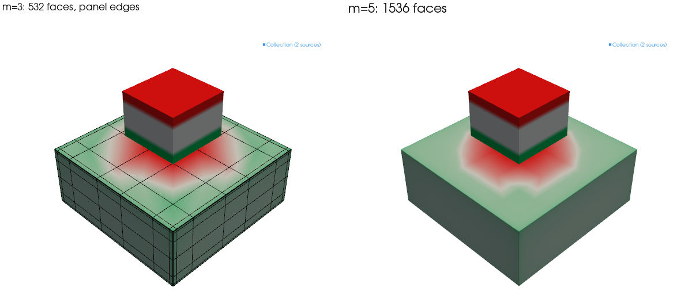

# Inside face charge

`solve_face_charge` puts the unknowns on the parts' surfaces only. This page
follows a solve from the physics to the fields of the result, with the papers
each step comes from. Code references are to
`src/magpylib_material_response/face_charge/`.

## Why the surface is enough

Inside a part of uniform, isotropic susceptibility $\chi$ and uniform remanence
$\mathbf{M}_0$, the magnetization is $\mathbf{M} = \mathbf{M}_0 + \chi
\mathbf{H}$, so $\nabla\cdot\mathbf{H} = \nabla\cdot\mathbf{M} / \chi$. With
$\nabla\cdot\mathbf{B} = \mu_0 \nabla\cdot(\mathbf{H} + \mathbf{M}) = 0$ that
gives

$$
\mu_0 \left(\frac{1}{\chi} + 1\right) \nabla\cdot\mathbf{M} = 0 ,
$$

so $\nabla\cdot\mathbf{M} = 0$: the part carries no magnetic charge in its
volume. Its whole field is that of the charge $\sigma =
\mathbf{M}\cdot\mathbf{n}$ on its surface, $\mathbf{n}$ the outward normal. An
anisotropic susceptibility, one that varies inside the part, or a B–H curve
breaks this, which is why those go to `solve_cells`.

## The equation

Just inside the surface, the normal field is the applied one, plus the field of
all the charge, minus half the local charge, the jump across a charged sheet.
Writing $\mathbf{M}\cdot\mathbf{n} = \sigma$ there gives one equation for
$\sigma$:

$$
\left(\frac{1}{\chi} + \frac{1}{2}\right) \sigma - K'\sigma
= \mathbf{H}_0\cdot\mathbf{n} + \frac{\mathbf{M}_0\cdot\mathbf{n}}{\chi}
$$

$\mathbf{H}_0$ is the field of every fixed source at the surface: magnets, coils
and a `UniformField`, from Magpylib. $K'$ is the adjoint double-layer operator,
the normal field at one point of the surface of a unit charge at another, which
depends on the shape only. Several parts share one system: each part's equation
holds the field of the others' charge.

The total charge of a closed part is zero. Each part's system is bordered with
one row and one column that fix it, or one per closed shell of a triangle mesh.

## Panels

Each face is cut into panels, and each panel carries a charge linear across it,
$c_0 + c_1 s + c_2 t$ in its local coordinates: three unknowns per panel,
discontinuous from one panel to the next.

- **Cuboids** (`_panels.py`, `_bodies.py`): rectangles. A soft part's charge is
  singular at its edges, so the panels are graded toward each edge: `level`
  panels fill a layer as deep as the part's smallest side, their edges at $\ell
  (k/m)^{2.5}$ for $k = 1 \ldots m$, and panels of the layer's largest size fill
  the rest of the face.
- **Triangle meshes** (`_mesh.py`, `_tribody.py`): the flat faces are merged
  back into polygons, so that a CAD export's long diagonals do not cross the
  layers, and each polygon is cut in rings inward from its sharp edges, where
  the triangles turn by more than 20°. The layers are as deep as half the part's
  thickness. A flat face with vertices inside it, as an FEM surface mesh has, is
  rebuilt from its outline, so it costs the same however it was cut.
- **Cylinders and spheres** (`_apply.py`): a curved face becomes
  `12 (level + 1)` flat facets per turn, widened so that the part keeps its true
  volume, and is then meshed as a triangle mesh. The widening matters more than
  the facets' number: on a soft cylinder at level 3, 24 widened facets are 0.02
  % off 50 mm away, 96 facets without it 0.16 %. A sphere is a geodesic
  polyhedron, finer with each level.

## The Galerkin system

The equation is tested with the panels' own functions, a Galerkin method: each
entry of the matrix is the flux of one panel's charge through another panel,
weighted by a test function.

$$
\left(\frac{1}{\chi} + \frac{1}{2}\right) \mathsf{M} c - \mathsf{G} c = F + \frac{F_0}{\chi}
$$

$\mathsf{M}$ is the (diagonal) mass matrix, $F$ and $F_0$ the loads of the
applied field and of the remanence. $\mathsf{G}$ holds the fluxes. They are
integrals, over the source panel, of the test panel's weighted solid angle,
which stays bounded where the field itself is logarithmically singular, at a
shared edge. Panels on one face give each other no flux.

- **Closed forms** (`_rectangle.py`, `_triangle.py`): the field of a flat
  rectangle or triangle with a linear charge is a sum over its edges of
  logarithms and arctangents {cite}`wilton1984,graglia1993`, and the solid angle
  of a triangle has a closed form too {cite}`oosterom1983`. They are checked
  against numerical integration to 1e-9.
- **Quadrature over the source panel**: the closed-form weighted solid angle of
  the test panel is integrated at the source panel's Gauss points; 7 points on a
  triangle, 4 × 7 for pairs about as close as they are long.
- **Far pairs** (`_panels.py`, `FAR_RULES`): in large systems, cuboid panel
  pairs at least 3 panel sides apart take 3 Gauss points per side instead of the
  closed form, 16 sides apart 2. This moves answers by under 1e-6 and makes
  assembly up to 1.55 times faster on 8 threads.

On a cube of infinite susceptibility the method reproduces the known
polarizability, 3.6443 times the volume {cite}`helsing2013`, from below, as a
Galerkin method should: 4.5e-4 off at level 4.

## Parts that touch or come close

- **Faces in one plane** (`_contact.py`) couple exactly. The flux of a charge
  through a test panel in its own plane jumps, and the one-sided limit from
  inside the test part gives −1/2 of the integral of the two charges over their
  overlap. The overlap of the two panels is clipped as a polygon and integrated
  exactly, so the two meshes need not match.
- **Parts of one material that touch** are solved as one: the faces they share
  carry no charge. A short bar between two wide ones is 0.83 % off the same
  solid as one mesh at level 2, where leaving both sides' charges to cancel was
  16 % off.
- **A part close to another** (`NEAR`), within 20 % of the largest half-side of
  the smaller of the two, is graded toward the other's outline, as for touching
  parts. A magnet without susceptibility counts too, when it is a cuboid: the
  panels follow its footprint, and the load near it takes a finer rule.

## Solving

All the parts form one dense system: $8 n^2$ bytes for $n$ unknowns, 3.2 GB at
the default `max_unknowns` of 20,000.

- **Below 2,000 unknowns**, a double-precision LU from LAPACK
  {cite}`lapack1999`.
- **From 2,000 unknowns** (`MIXED`), the LU is taken in single precision and
  refined against the double matrix to double's accuracy, as LAPACK's `dsgesv`
  does {cite}`langou2006,carson2018`: 2 to 4 times faster, fields within 2e-9.
  The single copy takes the 20,000-unknown system from 3.2 to 4.8 GB.
- **`reuse=True`** keeps the double LU on the result (`_kept.py`). A later call
  compares a fingerprint of what the matrix is built from: the panels as meshed,
  the susceptibilities, and the parts' poses relative to the first part. If it
  matches, only the load is new, and the solve is a back-substitution. The
  fingerprint is read off the meshed panels, not the input, so a magnet that
  comes close enough to regrade a part changes it by itself; a poor match solves
  afresh and never returns a wrong field.
- **`refine=k`** splits, k times, the panels where the solved charge jumps most
  and solves again: a rectangle in two along both axes, a triangle into four.

Above 20,000 unknowns a fast multipole method {cite}`greengard1987` or a
hierarchical matrix {cite}`hackbusch1999` would grow about linearly in memory.
Neither is built: below the cap the dense solve is faster, and in a loop a kept
LU beats any iteration.

## The result: `ChargeSheet`

Each solved part becomes a `ChargeSheet` (`_sheet.py`), a Magpylib
`CustomSource` that holds triangles and the charge at their corners, in the
part's place in the collection.

- **Its field** is the closed form near the sheet. An observer farther from the
  whole sheet than 64 of its longest triangle sides takes 6 points per triangle
  instead, exact to degree 4 {cite}`dunavant1985`: there the closed form loses
  digits to cancellation.
- **Inside the part** it gives μ0 H and a warning: B there needs the part's
  magnetization, which a surface charge does not carry.
- **`mean_polarization`** is the part's mean J: μ0 times the first moment of the
  charge, the integral of $\sigma \mathbf{r}$ over the surface, divided by the
  volume. It tells whether saturation matters.
- **`jump_indicator`** is the largest jump of the charge between neighbouring
  panels, weighted by panel size. The true charge is continuous on a flat face,
  so the jump is discretization error.
- **`field_matrix`** (`_matrix.py`) writes the sheets' field at fixed points as
  one matrix times their charges: for many solves read at the same points.

Assembly and fields run on `magpy.defaults.threads` threads, in chunks sized so
that all of them together take the memory one would alone (`_parallel.py`).
