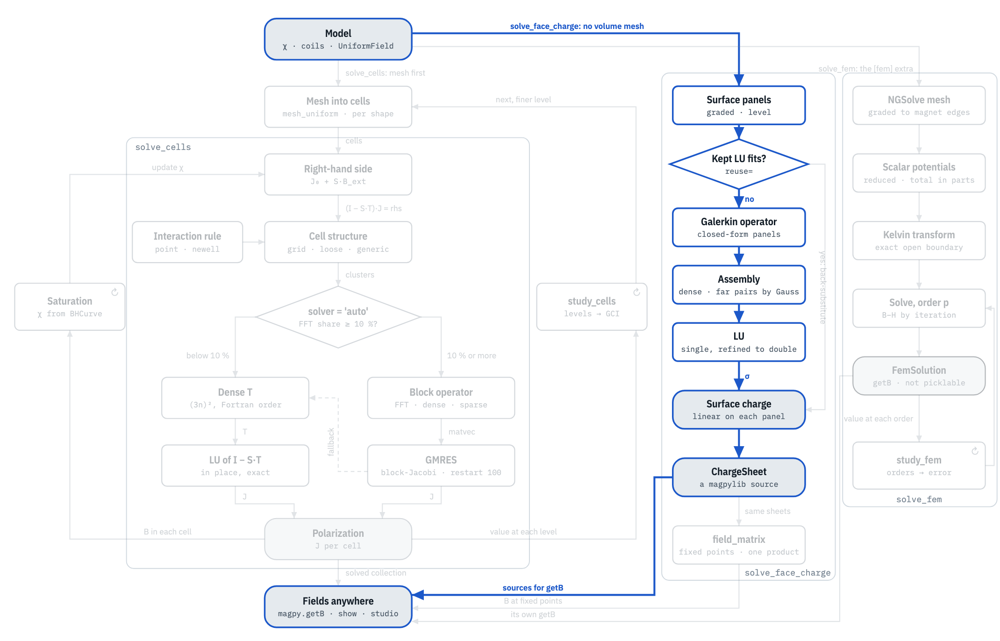

# Inside the solvers

All three solvers answer the same question: what polarization do the parts take
in the field of everything around them, their own field included? They differ in
where they put the unknowns.

## The physics they share

A part's material is linear, or follows a B–H curve. Its polarization
$\mathbf{J} = \mu_0 \mathbf{M}$, in tesla as Magpylib takes it, responds to the
field $\mathbf{H}$ inside it:

$$
\mathbf{J} = \mathbf{J}_r + \chi\, \mu_0 \mathbf{H}
$$

with $\mathbf{J}_r$ the remanence, zero for soft iron, and $\chi$ the
susceptibility. $\mathbf{H}$ is the field of every source in the model, the
fixed magnets, the currents and a `UniformField`, plus the field of the parts'
own polarization. That last term makes the problem self-consistent: each part's
polarization depends on all the others', its own included.

Magpylib gives the field of a uniformly polarized cuboid, cylinder, sphere or
tetrahedron in closed form {cite}`ortner2020,engelherbert2005,slanovc2022`.
Cells use it for the field of every cell; face charge for the field of the fixed
sources at its panels, its own panels having closed forms of their own; finite
elements only for the field of currents, as they mesh the magnets.

## Three discretizations

|                | [Cells](cells.md)                                         | [Face charge](face_charge.md)                         | [Finite elements](fem.md)                      |
| -------------- | --------------------------------------------------------- | ----------------------------------------------------- | ---------------------------------------------- |
| Unknown        | one polarization per cell, in the parts' volume           | a magnetic charge on the parts' surfaces              | a scalar potential in the parts and the air    |
| Equation       | J in each cell from the field of all cells                | each panel's charge M·n from the field just inside it | div B = 0 everywhere, in weak form             |
| Discretization | uniform cells, the field of one at another in closed form | panels, the charge linear on each, Galerkin           | tetrahedra, polynomials of order p             |
| System         | dense, 3 unknowns per cell; FFT on grids                  | dense, 3 unknowns per panel                           | sparse, iterative                              |
| Known as       | the magnetostatic moment method {cite}`chadebec2006`      | a boundary-integral (surface-charge) method           | the finite element method {cite}`schoberl2014` |

Face charge needs the least: a part that is linear, isotropic and uniform inside
has no magnetic charge in its volume, so its surface carries its whole response.
Cells drop that assumption and pay with a volume of unknowns that converges
slowly. Finite elements mesh the air as well, and close the open space exactly,
which makes them the independent reference.

## The map

The map follows a model through each solver, box by box. Below, the path of a
soft part solved by face charge is lit. In the interactive map you pick any of
34 models to light up its path, and click a box for what happens inside it and
the papers it rests on.

```{raw} html
<p><a href="map.html"></a></p>
<p><a href="map.html"><b>Open the interactive map →</b></a></p>
```

## The pages

- [The solver map](map.md): the interactive map, full width.
- [Inside cells](cells.md) and [the cell equations](cells_equations.md): the
  moment method, its interaction rules, solvers and fast paths.
- [Inside face charge](face_charge.md): the surface-charge equation, panels,
  contacts and the kept factorization.
- [Inside finite elements](fem.md): the potentials, the exact open boundary and
  the mesh.
- [Inside saturation](saturation.md): the B–H iteration of cells and finite
  elements.
- [Inside the error estimates](error_estimates.md): the grid convergence index,
  the order study and the jump indicator.

```{toctree}
:maxdepth: 1
:hidden:

map
cells
cells_equations
face_charge
fem
saturation
error_estimates
```
