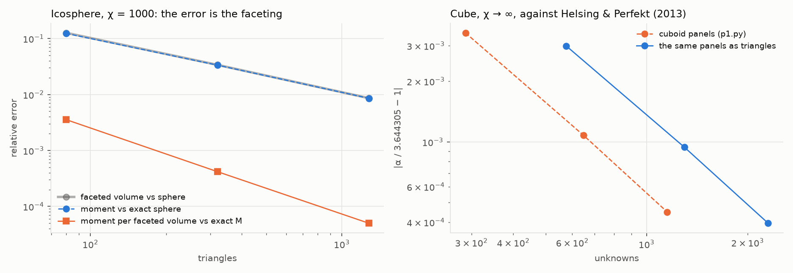
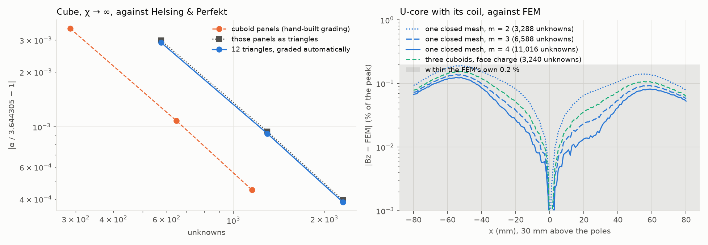

# Face charge on triangle meshes (CAD parts)

A homogeneous, isotropic, linear part is fully described by the charge on its
surface, so a CAD part needs only its surface triangles (a magpylib
`TriangularMesh`), no tetrahedra. This folder builds that solver step by step.

**Status: steps 1 and 2 of 4 done, and lean.** Next: step 3, a CAD-like part
with fillets and a hole. (step 2 costs 2.3× the unknowns and 7.5 GB where the
cuboid model needs 3,240), then step 3.

| Step | What                                                                                                                                      | Status |
| ---- | ----------------------------------------------------------------------------------------------------------------------------------------- | ------ |
| 1    | Linear charge per triangle; checked on a sphere and on a cube given as triangles                                                          | done   |
| 2    | Grade the mesh toward sharp edges (by the angle between neighbours); cube as triangles, then the U-core as one closed mesh against FEM    | todo   |
| 3    | A CAD-like part (fillets, a hole) against the tetrahedral MoM; a cylinder as `Cylinder` with curved panels vs as 32, 64, 128-sided meshes | todo   |
| 4    | Compression for large meshes (fast multipole or hierarchical matrices)                                                                    | todo   |

## Step 1: the solver

`tri.py`: the field of a flat triangle whose charge is 1, u or v (linear across
it), in closed form: Wilton's per-edge potential and solid angle, and the linear
part reduced to edge integrals, as in explore/cells-and-fem's `lintet.py`.
`tri_solver.py`: the same Galerkin scheme as the cuboid panels, on any closed
mesh. `meshes.py`: icosphere, and cuboid panels cut into triangles.

- **Kernel** (`t_tri.py`, `results/kernel.txt`): within 1e-9 of a quadrature
  refined toward each observer (0.003 to 3 away, in the plane), and a rectangle
  cut in two matches the rectangle closed form to 2.6e-13. A sign in the edge's
  foot point was wrong at first and gave O(1) errors; the check caught it.
- **Sphere** (χ 1 and 1000, uniform field; `step1.py`, `results/step1.*`): the
  moment's error follows the faceted volume's, −8.56e-3 against −8.61e-3 at
  1,280 triangles. Per unit of the faceted volume, the magnetization is within
  5e-5 of the exact sphere's. The faceting is the error; the solver adds little.
- **Cube as triangles** (χ → ∞): −2.9e-3, −9.9e-4, −4.6e-4 against Helsing &
  Perfekt's 3.644305, as the cuboid solver on the same panels (−3.5e-3, −1.1e-3,
  −4.5e-4), with twice the unknowns: each panel is two triangles.

Cost: dense; 3,840 unknowns in 2.4 s (1,280 triangles) since the lean step
below.

## Step 2: grading toward sharp edges

`refine.py`, `refine_cells`: sharp edges are the mesh edges whose triangles'
normals differ by more than 20° (convex or re-entrant). The flat faces are
merged back into convex polygons, so the export's diagonals are dropped. Along
each sharp edge, the polygons of each face beside it are cut along lines
parallel to it at the cuboid layers' distances ℓ (k/m)^g, k = 1..m, and the
cells fanned into triangles. Where two sharp edges meet, the lines cross into
the cuboid's grid. The rest is bisected (longest edge) down to g ℓ / m.

Two dead ends on the way, kept in the code's history:

- bisecting the edge longest in a stretched target metric made slivers, then
  collinear triangles, near corners;
- longest-edge bisection to an isotropic target is robust but costs 15 to 23
  times the cuboid's unknowns, as it fills every edge with small triangles.

Cutting the export's triangles without merging them back gave slivers where the
diagonals cross the layers. In-plane observers on an edge's extension gave NaN,
as in the rectangle kernel: they are now lifted 1e-12 of the triangle off its
plane.

- **Cube from 12 triangles** (`step2.py`, `results/step2.*`): −2.9e-3, −9.3e-4,
  −4.4e-4 against Helsing & Perfekt at 576, 1,440 and 2,448 unknowns: the
  hand-built cuboid panels, cut into triangles, give the same.
- **U-core as one closed mesh** (44 triangles in, 32 sharp edges, two of them
  re-entrant), χ 999, in its coil's field: at m = 2, 7,500 unknowns, Bz along
  the line 30 mm above the poles is within 0.19 % of the extrapolated FEM at
  worst (0.10 % RMS), peak 2.1581 mT against 2.1552. The FEM itself is good to
  0.2 %. The three-cuboid model of the validation gets 0.15 % with 3,240.
- **Lean mesh and assembly** (after the first version of this step, which cost
  7,500 unknowns, 36 s and 7.5 to 9.9 GB at m = 2):
  - the export's field was evaluated at 70,000 points in one magpylib call, 9.4
    GB on its own: now in chunks of 5,000, with 7 points per triangle;
  - the interior was bisected as triangles, 5 times the cells: long cells are
    now cut across into equal pieces, so a box gives exactly two triangles per
    cuboid panel;
  - the coupling needs only the normal component: a kernel for it, with every
    dot product as one matrix product (181 ns per pair), and the close pairs in
    one batched call instead of a Python loop;
  - close pairs were sized by sqrt(area), which missed the long thin layer
    strips, and the U-core's peak wandered by 0.1 % between levels: sized by
    their longest edge, it converges steadily.
- **U-core now:** m = 2, 3, 4 at 3,288, 6,588 and 11,016 unknowns in 3.0, 8.7
  and 21 s (5.4 GB at most): peak 2.1517, 2.1529, 2.1531 mT, within 0.19 %, 0.14
  % and 0.12 % of the FEM (good to 0.2 %). The three-cuboid model gives 2.1524,
  2.1529, 2.1532: the same geometry, the same answer. At m = 2 the one mesh
  costs what the three cuboids do (3,240 unknowns, 3.1 s, 0.15 %).
- **Cube from 12 triangles now:** −2.9e-3, −9.2e-4, −3.9e-4 in 0.2 to 1.7 s.

## How to resume

From this folder, with material-response's environment: `python step1.py` (about
a minute). Each step writes `results/step<k>.*`.
