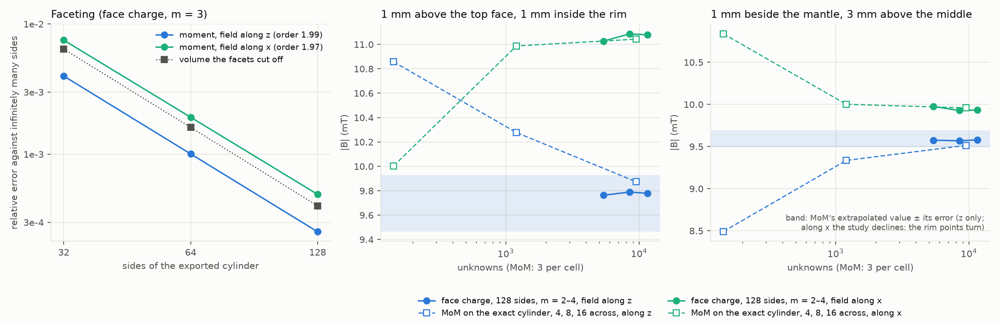
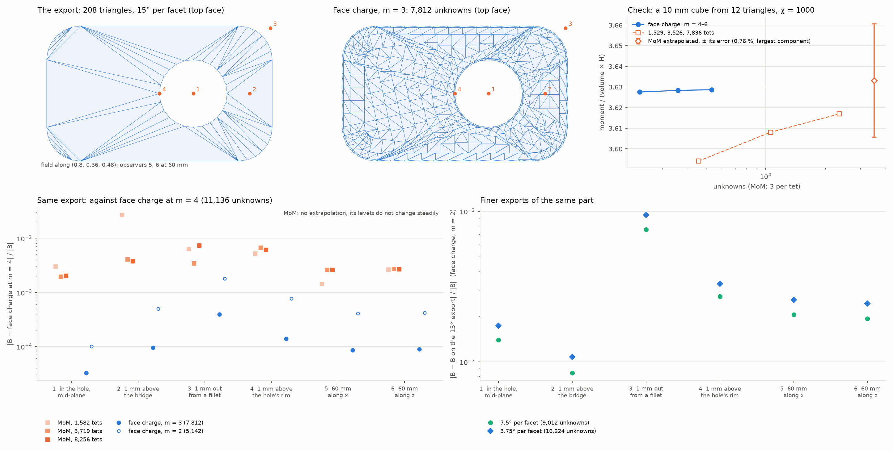

# Face charge on triangle meshes (CAD parts)

A homogeneous, isotropic, linear part is fully described by the charge on its
surface, so a CAD part needs only its surface triangles (a magpylib
`TriangularMesh`), no tetrahedra. This folder builds that solver step by step.

**Status: steps 1 to 3 of 4 done.** Next: step 4, compression, which would also
let a fine export's narrow facet strips share panels.

| Step | What                                                                                                                                                      | Status |
| ---- | --------------------------------------------------------------------------------------------------------------------------------------------------------- | ------ |
| 1    | Linear charge per triangle; checked on a sphere and on a cube given as triangles                                                                          | done   |
| 2    | Grade the mesh toward sharp edges (by the angle between neighbours); cube as triangles, then the U-core as one closed mesh against FEM                    | done   |
| 3    | (a) a cylinder exported with 32, 64, 128 sides against the MoM on the exact `Cylinder`; (b) a CAD-like part (fillets, a hole) against the tetrahedral MoM | done   |
| 4    | Compression for large meshes (fast multipole or hierarchical matrices)                                                                                    | todo   |

## Step 1: the solver

`tri.py`: the field of a flat triangle whose charge is 1, u or v (linear across
it), in closed form: Wilton's per-edge potential and solid angle, and the linear
part reduced to edge integrals, as in explore/cells-and-fem's `lintet.py`.
`tri_solver.py`: the same Galerkin scheme as the cuboid panels, on any closed
mesh. `meshes.py`: icosphere, and cuboid panels cut into triangles.

- **Kernel** (`t_tri.py`, `results/kernel.txt`): within 1e-9 of a quadrature
  refined toward each observer (0.003 to 3 away, in the plane), and a rectangle
  cut in two matches the rectangle closed form to 2.6e-13. A sign in the edge's
  foot point was wrong at first and gave O(1) errors; the check caught it.
- **Sphere** (χ 1 and 1000, uniform field; `step1.py`, `results/step1.*`): the
  moment's error follows the faceted volume's, −8.56e-3 against −8.61e-3 at
  1,280 triangles. Per unit of the faceted volume, the magnetization is within
  5e-5 of the exact sphere's. The faceting is the error; the solver adds little.
- **Cube as triangles** (χ → ∞): −2.9e-3, −9.9e-4, −4.6e-4 against Helsing &
  Perfekt's 3.644305, as the cuboid solver on the same panels (−3.5e-3, −1.1e-3,
  −4.5e-4), with twice the unknowns: each panel is two triangles.

Cost: dense; 3,840 unknowns in 2.4 s (1,280 triangles) since the lean step
below.

## Step 2: grading toward sharp edges

`refine.py`, `refine_cells`: sharp edges are the mesh edges whose triangles'
normals differ by more than 20° (convex or re-entrant). The flat faces are
merged back into convex polygons, so the export's diagonals are dropped. Along
each sharp edge, the polygons of each face beside it are cut along lines
parallel to it at the cuboid layers' distances ℓ (k/m)^g, k = 1..m, and the
cells fanned into triangles. Where two sharp edges meet, the lines cross into
the cuboid's grid. The rest is bisected (longest edge) down to g ℓ / m.

Two dead ends on the way, kept in the code's history:

- bisecting the edge longest in a stretched target metric made slivers, then
  collinear triangles, near corners;
- longest-edge bisection to an isotropic target is robust but costs 15 to 23
  times the cuboid's unknowns, as it fills every edge with small triangles.

Cutting the export's triangles without merging them back gave slivers where the
diagonals cross the layers. In-plane observers on an edge's extension gave NaN,
as in the rectangle kernel: they are now lifted 1e-12 of the triangle off its
plane.

- **Cube from 12 triangles** (`step2.py`, `results/step2.*`): −2.9e-3, −9.3e-4,
  −4.4e-4 against Helsing & Perfekt at 576, 1,440 and 2,448 unknowns: the
  hand-built cuboid panels, cut into triangles, give the same.
- **U-core as one closed mesh** (44 triangles in, 32 sharp edges, two of them
  re-entrant), χ 999, in its coil's field: at m = 2, 7,500 unknowns, Bz along
  the line 30 mm above the poles is within 0.19 % of the extrapolated FEM at
  worst (0.10 % RMS), peak 2.1581 mT against 2.1552. The FEM itself is good to
  0.2 %. The three-cuboid model of the validation gets 0.15 % with 3,240.
- **Lean mesh and assembly** (after the first version of this step, which cost
  7,500 unknowns, 36 s and 7.5 to 9.9 GB at m = 2):
  - the export's field was evaluated at 70,000 points in one magpylib call, 9.4
    GB on its own: now in chunks of 5,000, with 7 points per triangle;
  - the interior was bisected as triangles, 5 times the cells: long cells are
    now cut across into equal pieces, so a box gives exactly two triangles per
    cuboid panel;
  - the coupling needs only the normal component: a kernel for it, with every
    dot product as one matrix product (181 ns per pair), and the close pairs in
    one batched call instead of a Python loop;
  - close pairs were sized by sqrt(area), which missed the long thin layer
    strips, and the U-core's peak wandered by 0.1 % between levels: sized by
    their longest edge, it converges steadily.
- **U-core now:** m = 2, 3, 4 at 3,288, 6,588 and 11,016 unknowns in 3.0, 8.7
  and 21 s (5.4 GB at most): peak 2.1517, 2.1529, 2.1531 mT, within 0.19 %, 0.14
  % and 0.12 % of the FEM (good to 0.2 %). The three-cuboid model gives 2.1524,
  2.1529, 2.1532: the same geometry, the same answer. At m = 2 the one mesh
  costs what the three cuboids do (3,240 unknowns, 3.1 s, 0.15 %).
- **Cube from 12 triangles now:** −2.9e-3, −9.2e-4, −3.9e-4 in 0.2 to 1.7 s.

## Step 3a: a cylinder from its facets

A soft-iron cylinder (R = 5 mm, H = 10 mm, χ = 1000) in a uniform 10 mT field,
along its axis or across it, exported with 32, 64 or 128 flat sides
(`meshes.cylinder`), against material-response's MoM on the exact `Cylinder`
(`mesh_study` at 4, 8 and 16 cells across). Four observers: 1 mm above the top
face and 1 mm inside the rim, 1 mm beside the mantle, and 50 mm away on the axis
and across it (`step3_cylinder.py`, `results/step3_cylinder.*`).

`refine.py`, `refine_rings`: step 2's layers are lines parallel to a straight
edge; a rim turns a little at every facet, and those lines would cross the cap.
Here each flat face's polygons are offset inward along their sharp edges at the
layers' distances, so a cap gets rings and the mantle's strips straight layers.
Where two sharp edges turn by more than 30°, the cells near the corner are also
cut parallel to the other edge, as on the cuboid grid; a rim turns by 360°/N and
gets plain rings. At first a corner's cells were cut only when near both edges;
now near either, as on the cuboid grid.

- **Faceting is second order and small.** The moment converges as 1/N² (order
  1.99 along the axis, 1.97 across) and the volume the facets cut off is a fair
  guide: 128 sides are 2.5e-4 off along the axis and 4.9e-4 across, 32 sides
  4.0e-3 and 7.5e-3. The field 1 mm from the rim moves 1.1e-3 from 64 to 128
  sides. A CAD export at a usual chord tolerance is good to about 1e-3: curved
  panels are not needed.
- **The mesh converges by m = 3 to 4.** At 128 sides, m = 3 → 4 changes the
  field 1 mm from the rim by 0.11 %, the far field and the moment by 0.022 to
  0.027 %; m = 4 is about 1e-4 from its limit, below the 2.5e-4 to 4.9e-4 of the
  128 facets.
- **Against the MoM on the exact cylinder** (|B| in mT; face charge at 128
  sides, m = 4, 11,544 unknowns, 30 s and 6.7 GB; the MoM's three levels 13 min
  per field, under 4.9 GB):

  | Observer                   | Field | Face charge | MoM, 16 across | MoM, extrapolated |
  | -------------------------- | ----- | ----------- | -------------- | ----------------- |
  | 1 mm above, inside the rim | axial | 9.778       | 9.873          | 9.70 ± 2.4 %      |
  | 1 mm beside the mantle     | axial | 9.579       | 9.514          | 9.59 ± 1.0 %      |
  | 50 mm on the axis          | axial | 0.03824     | 0.03798        | 0.03822 ± 0.8 %   |
  | 50 mm across               | axial | 0.01928     | 0.01914        | 0.01927 ± 0.9 %   |
  | 1 mm above, inside the rim | cross | 11.078      | 11.043         | declined          |
  | 1 mm beside the mantle     | cross | 9.933       | 9.958          | declined          |
  | 50 mm on the axis          | cross | 0.01603     | 0.01598        | 0.01604 (\*)      |
  | 50 mm across               | cross | 0.03133     | 0.03124        | 0.03134 (\*)      |

  The face charge sits inside every band the MoM gives, and in the far field
  within 0.05 % of its extrapolation. The MoM's finest level differs from it by
  0.3 to 1 %. Across the axis, `mesh_study` declines to extrapolate, by design:
  near the rim Bz goes 9.61, 10.41, 10.38 mT, and the points that turn carry 23
  % of the last change, above its 10 % limit. (\*) Where the far points' steps
  shrink steadily (ratio 2.8 to 2.9), extrapolated here point by point.

- **Cost.** 64 sides at m = 3 (4,248 unknowns, 5 s) are within 0.27 % of the
  finest face charge everywhere, closer than the MoM's 3,168 cells. The MoM's
  cells are cylinder segments, slow to evaluate; its finest level takes most of
  the 13 minutes.

## Step 3b: a CAD-like part

A soft-iron plate, 20 × 12 × 4 mm, with its four vertical edges filleted (r = 3
mm) and a through-hole (r = 3 mm) 3 mm off centre; χ = 1000, μ0H = 10 mT along
(0.8, 0.36, 0.48), so no symmetry helps either method. `meshes.plate` exports it
as a CAD tool would: 15°, 7.5° or 3.75° per facet, each straight side one quad,
and the caps triangulated from their boundary vertices only, so they are long
thin triangles (208 triangles at 15°). Six observers: in the hole, 1 mm above
the bridge beside it, 1 mm out from a fillet, 1 mm above the hole's rim, and two
at 60 mm (`step3_plate.py`, `results/step3_plate.*`).

A first cap triangulation stitched outline and hole by the shorter diagonal; it
turned triangles over beside the off-centre hole and the area check caught it.
Delaunay of the boundary vertices keeps both boundaries here (the outline is
convex, the hole's chords short), and the cap's area is checked.

- **Face charge on the export as given** (no meshing by hand): m = 2, 3, 4 at
  5,142, 7,812 and 11,136 unknowns, 6, 12 and 21 s. m = 3 is within 3e-5 to
  3.9e-4 of m = 4 at the observers, the moment within 9e-5. The refined mesh
  keeps the export's area, volume and closure to round-off.
- **The tetrahedral MoM on the same export** (`mesh_study` on TetGen cells at
  1,582, 3,719 and 8,256 tets, 7, 40 and 248 s; the finest is about what fits in
  memory, as its matrix is dense): 0.20 to 0.73 % from face charge at the finest
  level, 0.26 % in the far field. Its levels do not change steadily (far Bx
  52.60, 52.52, 52.52 µT against 52.66), so `mesh_study` gives no estimate.
  TetGen's coarsest mesh is set by the export's long triangles (a target of 300
  gave 1,582 tets), not by the target: the levels are not a clean refinement,
  which is likely why they wander.
- **Who is right: a cube from 12 triangles**, same χ and field, where face
  charge is checked against Helsing & Perfekt (step 2). Face charge at m = 4, 5,
  6 (2,304 to 5,328 unknowns, 2 to 6 s): 3.62755, 3.62833, 3.62867 (moment /
  (volume × H)). The tetrahedral MoM at 1,529, 3,526 and 7,836 tets: −0.95,
  −0.57 and −0.32 %, converging at order 1.6, and its extrapolation lands 0.12 %
  from face charge, inside its own error (0.5 to 0.8 %). So at about 8,000 tets
  the tetrahedral MoM is still about 0.3 % low where it converges cleanly, and
  the plate's 0.26 % far-field gap, with the same sign, is that error.
- **The export's facets matter more than either solver.** The moment converges
  as 1/N² in the facets (order 1.95): the 15° export is 2.7e-3 off the smooth
  part, 7.5° 7.0e-4, 3.75° 1.8e-4. The field 1 mm out from a fillet moves 0.76 %
  from 15° to 7.5°. For 0.1 % in the far field, export at 7.5°; near curved
  faces, finer.
- **Cost of a fine export.** Each facet strip of the hole and the fillets is a
  flat face of its own, cut into its own layers, so the unknowns grow with the
  facets: 5,142, 9,012, 16,224 at m = 2 for 15°, 7.5°, 3.75° (30,024 at 3.75°, m
  = 4, not run). Panels that span several near-coplanar strips, or compression
  (step 4), would keep a fine export as cheap as a crude one.

## How to resume

From this folder, with material-response's environment: `python step1.py` (about
a minute). Each step writes `results/step<k>.*`. `python step3_cylinder.py` runs
only the cases missing from `results/step3_cylinder.json` (all of them: about 30
minutes, 26 of which are the MoM) and redraws the figure;
`python step3_plate.py` likewise (about 12 minutes, 7.7 GB at most, with the
material-response worktree's `src` on `PYTHONPATH`).
