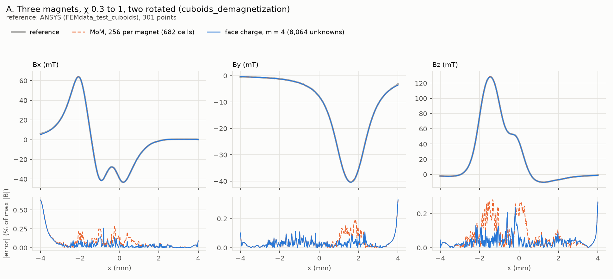

# Validation against the documented examples

Each documented example of material-response, solved by the face-charge method
and by the MoM as its page runs it, both against the page's reference. This file
is rewritten by `report.py` after every case; `run.py` appends the log below.

**1 of 6 cases done.** Next: B.

| Case | Model | Status | Reference | Face charge, finest level | MoM, docs settings, finest |
| --- | --- | --- | --- | --- | --- |
| A | Three magnets, χ 0.3 to 1, two rotated (cuboids_demagnetization) | done | ANSYS (FEMdata_test_cuboids), 301 points | 8,064 unknowns, 13.4 s: **max 0.64 %**, rms 0.13 % (last refinement changed it by 0.002 %) | 256 per magnet, 0.5 s: **max 0.64 %**, rms 0.18 % |
| B | Hard magnet (χ 0.5) and a turned soft cube (χ 3999) (soft_magnets) | todo | ANSYS (FEMdata_test_softmag), Bx and Bz, 3 lines of 1001 points | | |
| C | Flux concentrator, χ 4000 bar in the Earth's field (mesh_convergence) | todo | docs: MoM study on 4,096 to 262,144 cells, within 0.14 % | | |
| D | Halbach array of 5 magnets (χ 0.05) on back iron (χ 1000) (mesh_convergence) | todo | MoM study (2, 4, 8) extrapolated; docs: good to 0.03 % against 245,760 cells | | |
| E | Shielding sheet (24×24×1 mm, χ 1000) behind a magnet (mesh_convergence) | todo | docs: MoM study on 4,608 to 294,912 cells, within 3.3 %, 1.1 %, 0.09 % | | |
| F | U-core electromagnet (3 cuboids, χ 999) driven by a 16-winding coil (ucore_electromagnet) | todo | FEM (scikit-fem P2, explore/cells-and-fem), h = [3.0, 2.0, 1.5, 1.2, 1.0] mm, extrapolated over the three finest (order 1.17) | | |

Errors: for fields, |B − B_ref| at each observer over the largest |B_ref| on the
set; for gains and single sensors, relative per point. Times: face charge is
mesh, assembly and solve; the MoM is `apply_demag` alone, without meshing. The
face-charge mesh level m is set by hand, not converged by a study.

## How to resume

On branch `explore/face-charge`, from this folder, with material-response's
environment and `PYTHONPATH` at the branch's `src`:

```sh
PYTHONPATH=../../../src ./guard.sh 13 python run.py        # every case without a result
PYTHONPATH=../../../src ./guard.sh 13 python run.py C      # one case
PYTHONPATH=../../../src python run.py C --redo             # run it again
```

A case writes `results/<case>.json` (summary) and `results/<case>.npz` (the
compared values of every level and the reference) when it finishes, so stopping
loses at most the case that was running. `guard.sh 13` stops a run above 13 GB.

## Cases

### A. Three magnets, χ 0.3 to 1, two rotated (cuboids_demagnetization)

Reference: ANSYS (FEMdata_test_cuboids), 301 points. Compared: B T at 301 observers.

| Method | Size | Time | Max error | RMS error |
| --- | ---: | ---: | ---: | ---: |
| face charge, m = 2 | 2,016 unknowns | 0.9 s | 0.64 % | 0.13 % |
| face charge, m = 3 | 4,536 unknowns | 4.1 s | 0.64 % | 0.13 % |
| face charge, m = 4 | 8,064 unknowns | 13.4 s | 0.64 % | 0.13 % |
| MoM, 1 per magnet | 3 cells | 2 ms | 2.6 % | 1.2 % |
| MoM, 2 per magnet | 4 cells | 1 ms | 2.6 % | 1.1 % |
| MoM, 8 per magnet | 28 cells | 12 ms | 1.8 % | 0.77 % |
| MoM, 16 per magnet | 70 cells | 21 ms | 0.93 % | 0.46 % |
| MoM, 32 per magnet | 99 cells | 27 ms | 0.93 % | 0.42 % |
| MoM, 64 per magnet | 182 cells | 54 ms | 0.65 % | 0.28 % |
| MoM, 128 per magnet | 378 cells | 0.2 s | 0.65 % | 0.21 % |
| MoM, 256 per magnet | 682 cells | 0.5 s | 0.64 % | 0.18 % |



**Reading.** Face charge is converged from m = 2: 2,016 unknowns in 0.9 s,
within 1.4e-4 of m = 4. The MoM converges toward it, 2.2e-3 apart at 682 cells.
Where both differ most from ANSYS, they agree with each other: at x = −4 mm, the
end of the sensor line, both give Bx = 5.24 mT and ANSYS 6.05 mT. The jagged
error along the rest of the line is the FEM's mesh noise. So this case resolves
ANSYS's error, about 0.6 % at worst, and no less. For these weak magnets the
MoM is the cheaper of the two: 0.5 s at 682 cells.


## Log

- 2026-10-24 17:07 set up: six cases (A–F), harness, U-core FEM references copied from explore/cells-and-fem
- 2026-10-24 17:08 A: start
- 2026-10-24 17:08 A: face charge m=3: 4536 unknowns, build 2.0 s, couple+solve 2.2 s, field 0.1 s
- 2026-10-24 17:08 A: face charge m=4: 8064 unknowns, build 5.9 s, couple+solve 7.4 s, field 0.1 s
- 2026-10-24 17:10 A: face charge m=6: 18144 unknowns, build 29.2 s, couple+solve 46.9 s, field 0.2 s
- 2026-10-24 17:10 A: MoM 1 per magnet: 3 cells, 0.0 s
- 2026-10-24 17:10 A: MoM 2 per magnet: 4 cells, 0.0 s
- 2026-10-24 17:10 A: MoM 8 per magnet: 28 cells, 0.0 s
- 2026-10-24 17:10 A: MoM 16 per magnet: 70 cells, 0.0 s
- 2026-10-24 17:10 A: MoM 32 per magnet: 99 cells, 0.0 s
- 2026-10-24 17:10 A: MoM 64 per magnet: 182 cells, 0.1 s
- 2026-10-24 17:10 A: MoM 128 per magnet: 378 cells, 0.2 s
- 2026-10-24 17:10 A: MoM 256 per magnet: 682 cells, 0.4 s
- 2026-10-24 17:10 A: done. Face charge m=6: max error 6.4e-03 vs reference; MoM finest: 6.4e-03
- 2026-10-24 17:12 A redone: its first run had NaN at x = -2.00 mm (sensor in a face plane, on a panel edge's extension; lin_rect now lifts such observers 1e-12 of the panel off the plane), masked by nan-aware errors; run.py now refuses NaN. Levels 2, 3, 4: m = 6 bought nothing at 7.3 GB.
- 2026-10-24 17:12 A: start
- 2026-10-24 17:12 A: face charge m=2: 2016 unknowns, build 0.5 s, couple+solve 0.4 s, field 0.0 s
- 2026-10-24 17:12 A: face charge m=3: 4536 unknowns, build 2.0 s, couple+solve 2.2 s, field 0.1 s
- 2026-10-24 17:12 A: face charge m=4: 8064 unknowns, build 6.0 s, couple+solve 7.4 s, field 0.1 s
- 2026-10-24 17:13 A: MoM 1 per magnet: 3 cells, 0.0 s
- 2026-10-24 17:13 A: MoM 2 per magnet: 4 cells, 0.0 s
- 2026-10-24 17:13 A: MoM 8 per magnet: 28 cells, 0.0 s
- 2026-10-24 17:13 A: MoM 16 per magnet: 70 cells, 0.0 s
- 2026-10-24 17:13 A: MoM 32 per magnet: 99 cells, 0.0 s
- 2026-10-24 17:13 A: MoM 64 per magnet: 182 cells, 0.1 s
- 2026-10-24 17:13 A: MoM 128 per magnet: 378 cells, 0.2 s
- 2026-10-24 17:13 A: MoM 256 per magnet: 682 cells, 0.5 s
- 2026-10-24 17:13 A: done. Face charge m=4: max error 6.4e-03 vs reference; MoM finest: 6.4e-03
