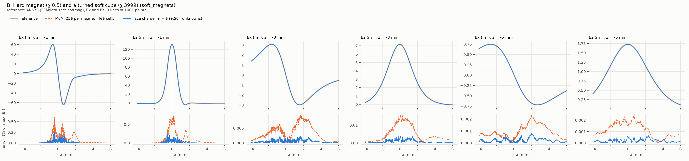
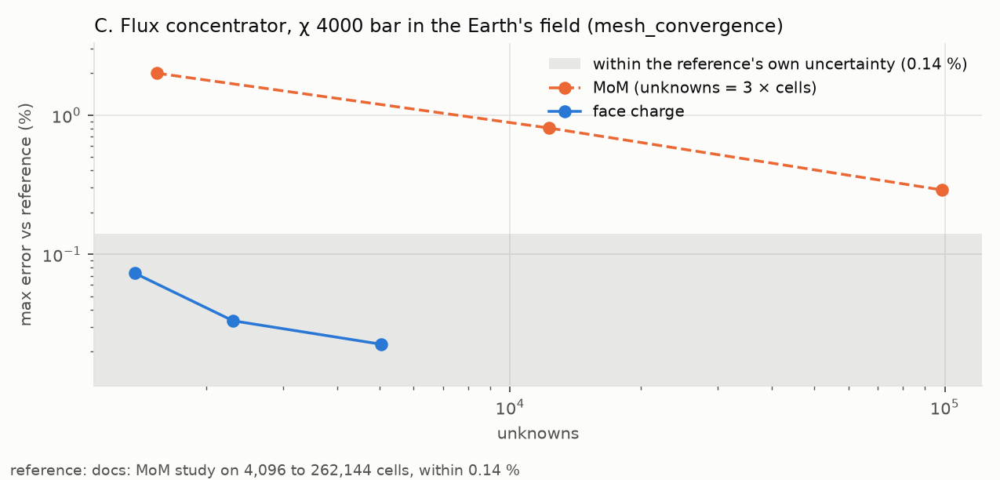
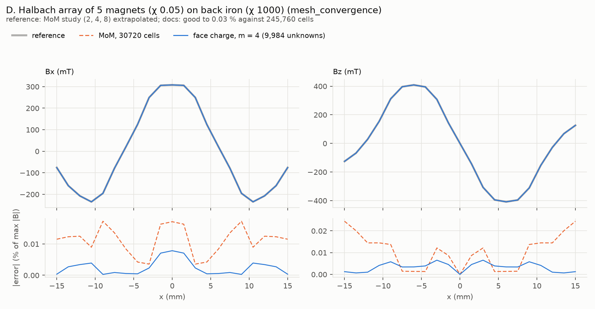
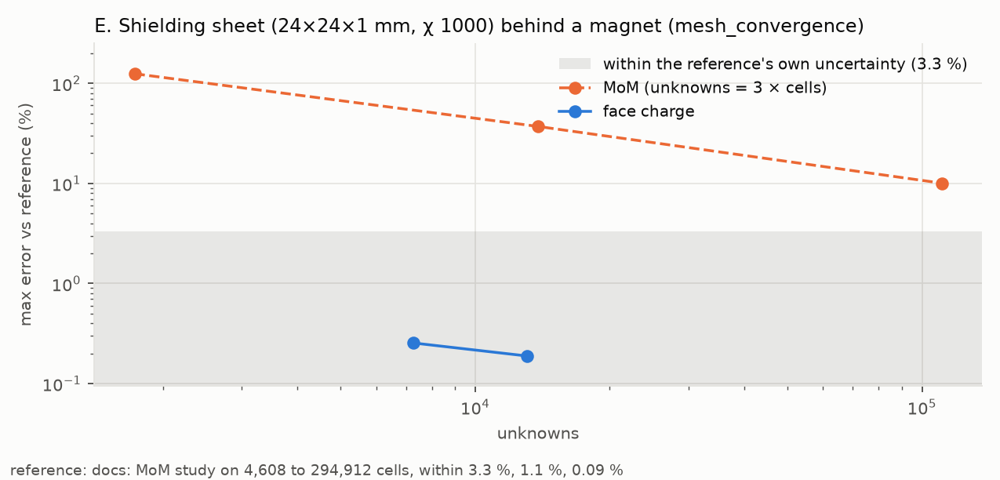
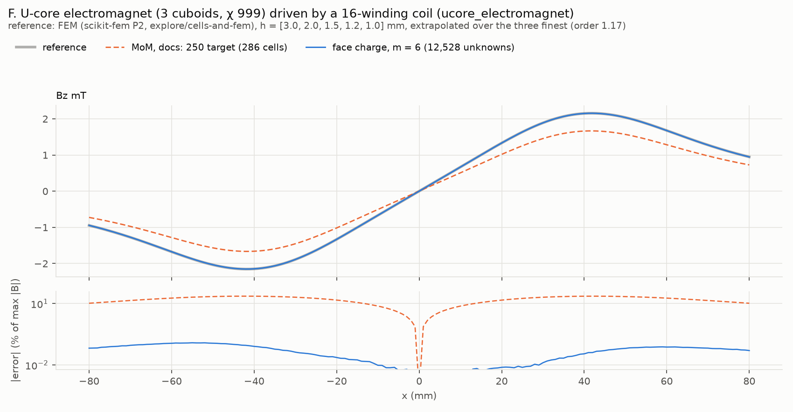

# Validation against the documented examples

Each documented example of material-response, solved by the face-charge method
and by the MoM as its page runs it, both against the page's reference. This file
is rewritten by `report.py` after every case; `run.py` appends the log below.

**6 of 6 cases done.** All done.

**Summary, all six cases.**

- **Accuracy.** Face charge agrees with every reference to within that
  reference's own uncertainty:
  - ANSYS: 0.64 % in A, at the end of the sensor line where the MoM agrees with
    face charge, not with ANSYS; 0.34 % in B;
  - the pages' MoM references: 0.023 % in C (good to 0.14 %), 0.010 % in D (0.03
    %), 0.19 % in E (3.3 %);
  - FEM: 0.12 % in F (0.2 %).

  In C, E and F it narrows the value further than the reference can.

- **The MoM at the pages' settings** is 0.64, 0.75, 0.29, 0.027, 10 and 23 %
  off. It is good on magnets and arrays (A, D) and poor near thin or large soft
  parts (E, F).
- **Time.** Face charge wins on soft iron, where the MoM needs many cells: 0.4 s
  against 8 s for four times the accuracy in C. It loses on weak magnets (A: 0.9
  s against 0.5 s at equal accuracy), on many touching bodies (D: 6.5 s against
  5.1 s), and on thin sheets (E: 8.6 s or more). In the last two the costs are
  the dense coupled system and panels sized to the thickness across a whole
  sheet.

| Case | Model                                                                                     | Status | Reference                                                                                                                     | Face charge, finest level                                                                    | MoM, docs settings, finest                        |
| ---- | ----------------------------------------------------------------------------------------- | ------ | ----------------------------------------------------------------------------------------------------------------------------- | -------------------------------------------------------------------------------------------- | ------------------------------------------------- |
| A    | Three magnets, χ 0.3 to 1, two rotated (cuboids_demagnetization)                          | done   | ANSYS (FEMdata_test_cuboids), 301 points                                                                                      | 8,064 unknowns, 13.4 s: **max 0.64 %**, rms 0.13 % (last refinement changed it by 0.002 %)   | 256 per magnet, 0.5 s: **max 0.64 %**, rms 0.18 % |
| B    | Hard magnet (χ 0.5) and a turned soft cube (χ 3999) (soft_magnets)                        | done   | ANSYS (FEMdata_test_softmag), Bx and Bz, 3 lines of 1001 points                                                               | 9,504 unknowns, 18.8 s: **max 0.34 %**, rms 0.027 % (last refinement changed it by 0.002 %)  | 256 per magnet, 0.2 s: **max 0.75 %**, rms 0.12 % |
| C    | Flux concentrator, χ 4000 bar in the Earth's field (mesh_convergence)                     | done   | docs: MoM study on 4,096 to 262,144 cells, within 0.14 %                                                                      | 5,040 unknowns, 4.7 s: **max 0.023 %**, rms 0.015 % (last refinement changed it by 0.024 %)  | 32768 cells, 8.0 s: **max 0.29 %**, rms 0.19 %    |
| D    | Halbach array of 5 magnets (χ 0.05) on back iron (χ 1000) (mesh_convergence)              | done   | MoM study (2, 4, 8) extrapolated; docs: good to 0.03 % against 245,760 cells                                                  | 9,984 unknowns, 21.1 s: **max 0.008 %**, rms 0.005 % (last refinement changed it by 0.001 %) | 30720 cells, 5.1 s: **max 0.027 %**, rms 0.018 %  |
| E    | Shielding sheet (24×24×1 mm, χ 1000) behind a magnet (mesh_convergence)                   | done   | docs: MoM study on 4,608 to 294,912 cells, within 3.3 %, 1.1 %, 0.09 %                                                        | 13,038 unknowns, 31.5 s: **max 0.19 %**, rms 0.12 % (last refinement changed it by 0.066 %)  | 36864 cells, 11.9 s: **max 10 %**, rms 5.9 %      |
| F    | U-core electromagnet (3 cuboids, χ 999) driven by a 16-winding coil (ucore_electromagnet) | done   | FEM (scikit-fem P2, explore/cells-and-fem), h = [3.0, 2.0, 1.5, 1.2, 1.0] mm, extrapolated over the three finest (order 1.17) | 12,528 unknowns, 38.2 s: **max 0.12 %**, rms 0.062 % (last refinement changed it by 0.017 %) | docs: 250 target, 0.2 s: **max 23 %**, rms 17 %   |

Errors: for fields and profiles, |B − B_ref| at each observer over the largest
|B_ref| on the set; for gains and a few single sensors, relative per point.
Times: face charge is mesh, assembly and solve; the MoM is `apply_demag` alone,
without meshing. The face-charge mesh level m is set by hand, not converged by a
study.

## How to resume

On branch `explore/face-charge`, from this folder, with material-response's
environment and `PYTHONPATH` at the branch's `src`:

```sh
PYTHONPATH=../../../src ./guard.sh 13 python run.py        # every case without a result
PYTHONPATH=../../../src ./guard.sh 13 python run.py C      # one case
PYTHONPATH=../../../src python run.py C --redo             # run it again
```

A case writes `results/<case>.json` (summary) and `results/<case>.npz` (the
compared values of every level and the reference) when it finishes, so stopping
loses at most the case that was running. `guard.sh 13` stops a run above 13 GB.

## Cases

### A. Three magnets, χ 0.3 to 1, two rotated (cuboids_demagnetization)

Reference: ANSYS (FEMdata_test_cuboids), 301 points. Compared: B T at 301
observers.

| Method              |           Size |   Time | Max error | RMS error |
| ------------------- | -------------: | -----: | --------: | --------: |
| face charge, m = 2  | 2,016 unknowns |  0.9 s |    0.64 % |    0.13 % |
| face charge, m = 3  | 4,536 unknowns |  4.1 s |    0.64 % |    0.13 % |
| face charge, m = 4  | 8,064 unknowns | 13.4 s |    0.64 % |    0.13 % |
| MoM, 1 per magnet   |        3 cells |   2 ms |     2.6 % |     1.2 % |
| MoM, 2 per magnet   |        4 cells |   1 ms |     2.6 % |     1.1 % |
| MoM, 8 per magnet   |       28 cells |  12 ms |     1.8 % |    0.77 % |
| MoM, 16 per magnet  |       70 cells |  21 ms |    0.93 % |    0.46 % |
| MoM, 32 per magnet  |       99 cells |  27 ms |    0.93 % |    0.42 % |
| MoM, 64 per magnet  |      182 cells |  54 ms |    0.65 % |    0.28 % |
| MoM, 128 per magnet |      378 cells |  0.2 s |    0.65 % |    0.21 % |
| MoM, 256 per magnet |      682 cells |  0.5 s |    0.64 % |    0.18 % |


**Reading.** Face charge is converged from m = 2: 2,016 unknowns in 0.9 s,
within 1.4e-4 of m = 4. The MoM converges toward it, 2.2e-3 apart at 682 cells.
Where both differ most from ANSYS, they agree with each other: at x = −4 mm, the
end of the sensor line, both give Bx = 5.24 mT and ANSYS 6.05 mT. The jagged
error along the rest of the line is the FEM's mesh noise. So this case resolves
ANSYS's error, about 0.6 % at worst, and no less. For these weak magnets the MoM
is the cheaper of the two: 0.5 s at 682 cells.

### B. Hard magnet (χ 0.5) and a turned soft cube (χ 3999) (soft_magnets)

Reference: ANSYS (FEMdata_test_softmag), Bx and Bz, 3 lines of 1001 points.
Compared: B T at 3003 observers.

| Method              |           Size |   Time | Max error | RMS error |
| ------------------- | -------------: | -----: | --------: | --------: |
| face charge, m = 3  | 2,376 unknowns |  1.2 s |    0.34 % |   0.027 % |
| face charge, m = 4  | 4,224 unknowns |  3.6 s |    0.34 % |   0.027 % |
| face charge, m = 6  | 9,504 unknowns | 18.8 s |    0.34 % |   0.027 % |
| MoM, 1 per magnet   |        2 cells |   2 ms |      11 % |       2 % |
| MoM, 2 per magnet   |        3 cells |   1 ms |     7.1 % |     1.3 % |
| MoM, 8 per magnet   |       20 cells |   6 ms |     4.7 % |     0.8 % |
| MoM, 16 per magnet  |       43 cells |  18 ms |     3.2 % |    0.53 % |
| MoM, 32 per magnet  |       72 cells |  25 ms |     2.3 % |    0.38 % |
| MoM, 64 per magnet  |      118 cells |  39 ms |     1.7 % |    0.28 % |
| MoM, 128 per magnet |      253 cells |  91 ms |     1.1 % |    0.17 % |
| MoM, 256 per magnet |      466 cells |  0.2 s |    0.75 % |    0.12 % |



**Reading.** The dataset interleaves the three sensor lines step by step, as the
page's dataframe does; read that way, face charge is within 0.34 % of ANSYS at
worst and 0.027 % RMS, converged from m = 3 (1.2 s, within 6e-5 of m = 6). The
MoM's finest, 466 cells in 0.2 s, is at 0.75 % and 0.12 %, and still moves by
3e-3 between its last two levels. On every line its error is 3 to 10 times the
face-charge one and has a shape: bumps beside the magnets. The face-charge error
has none, it looks like the FEM's mesh noise. The worst point for both is 0.5 mm
under the hard magnet's edge: Bx is 60.12 mT by face charge, 59.68 by ANSYS,
60.52 by the MoM, which approaches face charge as it refines.

### C. Flux concentrator, χ 4000 bar in the Earth's field (mesh_convergence)

Reference: docs: MoM study on 4,096 to 262,144 cells, within 0.14 %. Compared:
gain at 3 observers.

| Method                    |           Size |  Time | Max error | RMS error |
| ------------------------- | -------------: | ----: | --------: | --------: |
| face charge, m = 3        | 1,368 unknowns | 0.4 s |   0.073 % |   0.051 % |
| face charge, m = 4        | 2,304 unknowns | 1.0 s |   0.033 % |   0.027 % |
| face charge, m = 6        | 5,040 unknowns | 4.7 s |   0.023 % |   0.015 % |
| MoM, 512 cells            |      512 cells | 89 ms |       2 % |     1.3 % |
| MoM, 4096 cells           |    4,096 cells | 1.2 s |    0.81 % |    0.52 % |
| MoM, 32768 cells          |   32,768 cells | 8.0 s |    0.29 % |    0.19 % |
| MoM study's extrapolation |                |       |   0.066 % |   0.042 % |



**Reading.** Face charge gives the gains 4.2594, 3.3468 and 2.1679 at m = 6,
within 0.023 % of the reference's 4.259, 3.346 and 2.168. That reference is a
MoM study on up to 262,144 cells, good to 0.14 % and quoted to four digits, so
face charge agrees with it as closely as it can be read. Already at m = 3 (0.4
s) face charge is within 0.073 %. The MoM at the page's finest level, 32,768
cells in 8.0 s, is 0.29 % off; its study's extrapolation, 0.066 %.

### D. Halbach array of 5 magnets (χ 0.05) on back iron (χ 1000) (mesh_convergence)

Reference: MoM study (2, 4, 8) extrapolated; docs: good to 0.03 % against
245,760 cells. Compared: B T at 21 observers.

| Method             |           Size |   Time | Max error | RMS error |
| ------------------ | -------------: | -----: | --------: | --------: |
| face charge, m = 3 | 5,616 unknowns |  6.5 s |    0.01 % |   0.006 % |
| face charge, m = 4 | 9,984 unknowns | 21.1 s |   0.008 % |   0.005 % |
| MoM, 480 cells     |      480 cells |  81 ms |    0.21 % |    0.15 % |
| MoM, 3840 cells    |    3,840 cells |  0.7 s |   0.078 % |   0.052 % |
| MoM, 30720 cells   |   30,720 cells |  5.1 s |   0.027 % |   0.018 % |



**Reading.** The reference here is the MoM study's extrapolation, which the page
finds good to 0.03 % against 245,760 cells. Face charge agrees with it to 0.010
% at m = 3 and 0.008 % at m = 4, which agree with each other to 1.5e-5: face
charge is at least as accurate as this reference. The MoM's finest level, 30,720
cells, is 0.027 % off. Time is about even here: six touching bodies make a
coupled dense system of 5,616 unknowns (6.5 s at m = 3), against 5.1 s for the
MoM's FFT solve on 30,720 cells. By is zero by symmetry and not drawn.

### E. Shielding sheet (24×24×1 mm, χ 1000) behind a magnet (mesh_convergence)

Reference: docs: MoM study on 4,608 to 294,912 cells, within 3.3 %, 1.1 %, 0.09
%. Compared: |B| mT at 3 observers.

| Method                    |            Size |   Time | Max error | RMS error |
| ------------------------- | --------------: | -----: | --------: | --------: |
| face charge, m = 2        |  7,254 unknowns |  8.6 s |    0.25 % |    0.16 % |
| face charge, m = 3        | 13,038 unknowns | 31.5 s |    0.19 % |    0.12 % |
| MoM, 576 cells            |       576 cells |  0.2 s | 1.2e+02 % |      73 % |
| MoM, 4608 cells           |     4,608 cells |  1.5 s |      37 % |      22 % |
| MoM, 36864 cells          |    36,864 cells | 11.9 s |      10 % |     5.9 % |
| MoM study's extrapolation |                 |        |     1.9 % |     1.1 % |



**Reading.** Behind the sheet, face charge gives 5.530, 5.846 and 8.795 mT at m
= 3, and m = 2 differs by at most 0.07 %. The reference, a MoM study on up to
294,912 cells, says 5.52, 5.85 and 8.80, but is itself only good to 3.3 %, 1.1 %
and 0.09 %: face charge lands 0.19 % from it at worst, well inside that, and
narrows the values far below it. The MoM at the page's finest level, 36,864
cells in 11.9 s, is 10 % off on the axis; its study's extrapolation, 1.9 %. Face
charge costs more here, 8.6 s at m = 2 and 31.5 s and 5 GB at m = 3: the panels
are sized to the 1 mm thickness across the whole 24 mm sheet.

### F. U-core electromagnet (3 cuboids, χ 999) driven by a 16-winding coil (ucore_electromagnet)

Reference: FEM (scikit-fem P2, explore/cells-and-fem), h = [3.0, 2.0, 1.5, 1.2,
1.0] mm, extrapolated over the three finest (order 1.17). Compared: Bz mT at 161
observers.

| Method                |            Size |   Time | Max error | RMS error |
| --------------------- | --------------: | -----: | --------: | --------: |
| face charge, m = 3    |  3,240 unknowns |  3.1 s |    0.15 % |   0.088 % |
| face charge, m = 4    |  5,568 unknowns |  8.1 s |    0.14 % |   0.073 % |
| face charge, m = 6    | 12,528 unknowns | 38.2 s |    0.12 % |   0.062 % |
| MoM, docs: 250 target |       286 cells |  0.2 s |      23 % |      17 % |



**Reading.** Face charge's peak Bz is 2.1524, 2.1529 and 2.1532 mT at m = 3, 4
and 6. The FEM's peaks fall with its mesh, 2.1787 at h = 3 mm to 2.1603 at 1 mm,
and extrapolate to 2.1552; the cells-and-fem study put the reference at 2.152 ±
0.2 %. Face charge is within 0.1 % of both and within 0.12 % of the extrapolated
profile everywhere: the agreement is as close as the reference allows. The
page's MoM setting, 286 cells, is 23 % low; cells-and-fem measured uniform
cuboid cells still 6 % low at 3,773 cells. Face charge takes 3.1 s at m = 3
(3,240 unknowns), 38 s and 7 GB at m = 6.

## Log

- 2026-10-24 17:07 set up: six cases (A–F), harness, U-core FEM references
  copied from explore/cells-and-fem
- 2026-10-24 17:08 A: start
- 2026-10-24 17:08 A: face charge m=3: 4536 unknowns, build 2.0 s, couple+solve
  2.2 s, field 0.1 s
- 2026-10-24 17:08 A: face charge m=4: 8064 unknowns, build 5.9 s, couple+solve
  7.4 s, field 0.1 s
- 2026-10-24 17:10 A: face charge m=6: 18144 unknowns, build 29.2 s,
  couple+solve 46.9 s, field 0.2 s
- 2026-10-24 17:10 A: MoM 1 per magnet: 3 cells, 0.0 s
- 2026-10-24 17:10 A: MoM 2 per magnet: 4 cells, 0.0 s
- 2026-10-24 17:10 A: MoM 8 per magnet: 28 cells, 0.0 s
- 2026-10-24 17:10 A: MoM 16 per magnet: 70 cells, 0.0 s
- 2026-10-24 17:10 A: MoM 32 per magnet: 99 cells, 0.0 s
- 2026-10-24 17:10 A: MoM 64 per magnet: 182 cells, 0.1 s
- 2026-10-24 17:10 A: MoM 128 per magnet: 378 cells, 0.2 s
- 2026-10-24 17:10 A: MoM 256 per magnet: 682 cells, 0.4 s
- 2026-10-24 17:10 A: done. Face charge m=6: max error 6.4e-03 vs reference; MoM
  finest: 6.4e-03
- 2026-10-24 17:12 A redone: its first run had NaN at x = -2.00 mm (sensor in a
  face plane, on a panel edge's extension; lin_rect now lifts such observers
  1e-12 of the panel off the plane), masked by nan-aware errors; run.py now
  refuses NaN. Levels 2, 3, 4: m = 6 bought nothing at 7.3 GB.
- 2026-10-24 17:12 A: start
- 2026-10-24 17:12 A: face charge m=2: 2016 unknowns, build 0.5 s, couple+solve
  0.4 s, field 0.0 s
- 2026-10-24 17:12 A: face charge m=3: 4536 unknowns, build 2.0 s, couple+solve
  2.2 s, field 0.1 s
- 2026-10-24 17:12 A: face charge m=4: 8064 unknowns, build 6.0 s, couple+solve
  7.4 s, field 0.1 s
- 2026-10-24 17:13 A: MoM 1 per magnet: 3 cells, 0.0 s
- 2026-10-24 17:13 A: MoM 2 per magnet: 4 cells, 0.0 s
- 2026-10-24 17:13 A: MoM 8 per magnet: 28 cells, 0.0 s
- 2026-10-24 17:13 A: MoM 16 per magnet: 70 cells, 0.0 s
- 2026-10-24 17:13 A: MoM 32 per magnet: 99 cells, 0.0 s
- 2026-10-24 17:13 A: MoM 64 per magnet: 182 cells, 0.1 s
- 2026-10-24 17:13 A: MoM 128 per magnet: 378 cells, 0.2 s
- 2026-10-24 17:13 A: MoM 256 per magnet: 682 cells, 0.5 s
- 2026-10-24 17:13 A: done. Face charge m=4: max error 6.4e-03 vs reference; MoM
  finest: 6.4e-03
- 2026-10-24 17:14 B: start
- 2026-10-24 17:14 B: face charge m=3: 2376 unknowns, build 0.7 s, couple+solve
  0.5 s, field 0.3 s
- 2026-10-24 17:14 B: face charge m=4: 4224 unknowns, build 1.9 s, couple+solve
  1.6 s, field 0.5 s
- 2026-10-24 17:15 B: face charge m=6: 9504 unknowns, build 9.3 s, couple+solve
  9.2 s, field 1.1 s
- 2026-10-24 17:15 B: MoM 1 per magnet: 2 cells, 0.0 s
- 2026-10-24 17:15 B: MoM 2 per magnet: 3 cells, 0.0 s
- 2026-10-24 17:15 B: MoM 8 per magnet: 20 cells, 0.0 s
- 2026-10-24 17:15 B: MoM 16 per magnet: 43 cells, 0.0 s
- 2026-10-24 17:15 B: MoM 32 per magnet: 72 cells, 0.0 s
- 2026-10-24 17:15 B: MoM 64 per magnet: 118 cells, 0.0 s
- 2026-10-24 17:15 B: MoM 128 per magnet: 253 cells, 0.1 s
- 2026-10-24 17:15 B: MoM 256 per magnet: 466 cells, 0.2 s
- 2026-10-24 17:15 B: done. Face charge m=6: max error 1.0e+00 vs reference; MoM
  finest: 1.0e+00
- 2026-10-24 17:16 B redone: the dataset interleaves the three sensor lines step
  by step (the page's dataframe order); the first run read it in blocks, so both
  methods showed ~100 % error.
- 2026-10-24 17:16 B: start
- 2026-10-24 17:16 B: face charge m=3: 2376 unknowns, build 0.7 s, couple+solve
  0.5 s, field 0.3 s
- 2026-10-24 17:16 B: face charge m=4: 4224 unknowns, build 1.9 s, couple+solve
  1.7 s, field 0.5 s
- 2026-10-24 17:16 B: face charge m=6: 9504 unknowns, build 9.4 s, couple+solve
  9.4 s, field 1.1 s
- 2026-10-24 17:16 B: MoM 1 per magnet: 2 cells, 0.0 s
- 2026-10-24 17:16 B: MoM 2 per magnet: 3 cells, 0.0 s
- 2026-10-24 17:16 B: MoM 8 per magnet: 20 cells, 0.0 s
- 2026-10-24 17:16 B: MoM 16 per magnet: 43 cells, 0.0 s
- 2026-10-24 17:16 B: MoM 32 per magnet: 72 cells, 0.0 s
- 2026-10-24 17:16 B: MoM 64 per magnet: 118 cells, 0.0 s
- 2026-10-24 17:16 B: MoM 128 per magnet: 253 cells, 0.1 s
- 2026-10-24 17:16 B: MoM 256 per magnet: 466 cells, 0.2 s
- 2026-10-24 17:16 B: done. Face charge m=6: max error 3.4e-03 vs reference; MoM
  finest: 7.5e-03
- 2026-10-24 17:17 C: start
- 2026-10-24 17:17 C: face charge m=3: 1368 unknowns, build 0.4 s, couple+solve
  0.0 s, field 0.0 s
- 2026-10-24 17:17 C: face charge m=4: 2304 unknowns, build 1.0 s, couple+solve
  0.1 s, field 0.0 s
- 2026-10-24 17:17 C: face charge m=6: 5040 unknowns, build 4.3 s, couple+solve
  0.4 s, field 0.0 s
- 2026-10-24 17:17 C: MoM study level 512 cells, 0.1 s
- 2026-10-24 17:17 C: MoM study level 4096 cells, 1.2 s
- 2026-10-24 17:17 C: MoM study level 32768 cells, 8.0 s
- 2026-10-24 17:17 C: done. Face charge m=6: max error 2.3e-04 vs reference; MoM
  finest: 2.9e-03
- 2026-10-24 17:18 D: start
- 2026-10-24 17:18 D: face charge m=3: 5616 unknowns, build 1.5 s, couple+solve
  5.0 s, field 0.0 s
- 2026-10-24 17:19 D: face charge m=4: 9984 unknowns, build 4.4 s, couple+solve
  16.7 s, field 0.0 s
- 2026-10-24 17:19 D: MoM study level 480 cells, 0.1 s
- 2026-10-24 17:19 D: MoM study level 3840 cells, 0.7 s
- 2026-10-24 17:19 D: MoM study level 30720 cells, 5.1 s
- 2026-10-24 17:19 D: done. Face charge m=4: max error 8.4e-05 vs reference; MoM
  finest: 2.7e-04
- 2026-10-24 17:20 E: start
- 2026-10-24 17:20 E: face charge m=2: 7254 unknowns, build 7.4 s, couple+solve
  1.2 s, field 0.0 s
- 2026-10-24 17:21 E: face charge m=3: 13038 unknowns, build 24.2 s,
  couple+solve 7.3 s, field 0.0 s
- 2026-10-24 17:21 E: MoM study level 576 cells, 0.2 s
- 2026-10-24 17:21 E: MoM study level 4608 cells, 1.5 s
- 2026-10-24 17:21 E: MoM study level 36864 cells, 11.9 s
- 2026-10-24 17:21 E: done. Face charge m=3: max error 1.9e-03 vs reference; MoM
  finest: 1.0e-01
- 2026-10-24 17:22 F: start
- 2026-10-24 17:22 F failed at the start: its cuboids have polarization None,
  which fc.py turned into a NaN scalar; now None means no remanence.
- 2026-10-24 17:23 F: start
- 2026-10-24 17:23 F: face charge m=3: 3240 unknowns, build 0.8 s, couple+solve
  2.4 s, field 0.0 s
- 2026-10-24 17:23 F: face charge m=4: 5568 unknowns, build 2.2 s, couple+solve
  6.2 s, field 0.0 s
- 2026-10-24 17:23 F: face charge m=6: 12528 unknowns, build 10.3 s,
  couple+solve 27.9 s, field 0.1 s
- 2026-10-24 17:23 F: MoM docs: 250 target: 286 cells, 0.2 s
- 2026-10-24 17:23 F: done. Face charge m=6: max error 1.0e+00 vs reference; MoM
  finest: 1.0e+00
- 2026-10-24 17:24 F redone: its Bz profile crosses zero, so the per-point
  relative error read 100 %; profiles of one value over 10 points are now
  measured like fields, against the largest |reference|.
- 2026-10-24 17:24 F: start
- 2026-10-24 17:24 F: face charge m=3: 3240 unknowns, build 0.8 s, couple+solve
  2.3 s, field 0.0 s
- 2026-10-24 17:24 F: face charge m=4: 5568 unknowns, build 2.2 s, couple+solve
  5.9 s, field 0.0 s
- 2026-10-24 17:25 F: face charge m=6: 12528 unknowns, build 10.3 s,
  couple+solve 27.9 s, field 0.1 s
- 2026-10-24 17:25 F: MoM docs: 250 target: 286 cells, 0.2 s
- 2026-10-24 17:25 F: done. Face charge m=6: max error 1.2e-03 vs reference; MoM
  finest: 2.3e-01
