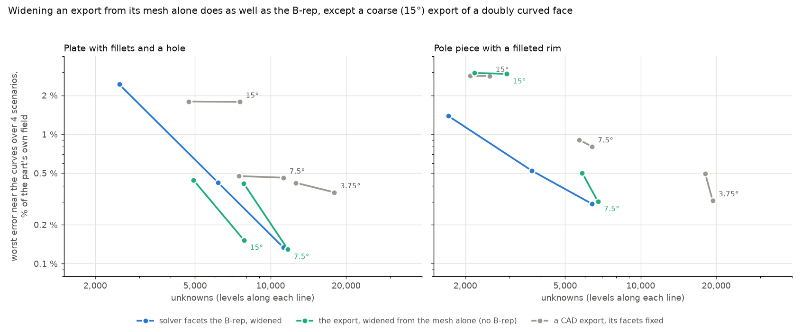

# B-rep parts for face charge: study

**Question.** A STEP file holds a part's exact geometry (B-rep); an STL export
cuts its curved faces into facets of the exporter's choosing. Would a source
that keeps the B-rep, and lets the solver facet curved faces itself, as it does
a `Cylinder` today, beat solving the export? In unknowns and time for the same
accuracy, against a reference on the exact geometry.

**Parts** (`geometry.py`), soft iron χ = 1000 in a 10 mT field along
(0.8, 0.36, 0.48), sensors near the curves and 60 mm away:

- `plate`: the validation's CAD plate, 20 × 12 × 4 mm, 3 mm fillets on its
  vertical edges, a 3 mm hole: curved faces are a small part of its surface.
- `pole`: a Ø20 × 10 mm bar with its top rim filleted 3 mm: curved faces are
  most of it.

**Arms** (`arms.py`): an export at 12, 24, 48, 96 facets per turn, fixed,
solved at levels 1 to 3; the solver's own faceting, `12 (level + 1)` per turn,
widened to keep the volume or not.

**Reference** (`reference.py`): finite elements on the exact OpenCASCADE solid,
curved elements, orders 3 to 5, as `validation/references.py` makes one.

## Steps

| Step | What | Status | Result |
| --- | --- | --- | --- |
| 1 | Geometry: exact solids, facetings, volumes | done | widened facetings keep the exact volume; unwidened lose 0.4 % (plate) to 5 % (pole) at 12/turn |
| 2 | Exact references, plate and pole | done | plate 0.012 % of B near the curves (35 s, 4.6 GB); pole 0.004 % (29 s, 11.4 GB); the solver checked to mesh the exact solid |
| 3 | Arms, plate and pole | done | `results/arms_*.jsonl`, 36 solves under the perf lock, best of two |
| 4 | Figures and conclusion | done | below |

## Result

1. **An export's facets set a floor that the level does not lower.** Raising
   the level converges to the faceted part, not to the real one: at 30° the
   plate stays near 2.8 % and the pole near 4 %; at 15° about 0.6 % and 1.4 %;
   at 7.5° the pole stays near 0.42 %.
2. **Facets cut by the solver from the exact curve, widened to keep the volume,
   converge with the level:** plate 0.76, 0.16, 0.044 %; pole 0.46, 0.10,
   0.042 % at levels 1, 2, 3.
3. **For the same error, far fewer unknowns.** Pole: 0.10 % with 3,678 unknowns
   in 0.37 s, where the finest export (3.75°) reaches 0.115 % with 19,350 in
   6.9 s: 5 times fewer unknowns, 19 times faster. Plate: 0.044 % with 11,256
   in 2.1 s against the 3.75° export's 0.043 % with 17,952 in 5.7 s: 1.6 and
   2.7 times.
4. **Most of the gain is the widening, which needs the exact curve.** With the
   same facets, widened against left on the curve: pole 0.042 against 0.42 %
   at level 3, plate 0.044 against 0.16 %. An export cannot be widened: it
   does not say which vertices lie on which curve, or where its centre is.
5. **Far away it holds too:** 60 mm off, as a share of the part's own field,
   widened facets at level 3 are 0.013 % (plate) and 0.012 % (pole) off,
   against 0.032 % and 0.11 % for the 3.75° export.
6. **Level 1 is too coarse to judge:** there the plate's unwidened facets come
   out better (0.21 against 0.76 %), by errors that cancel; from level 2 on
   the widened ones win on both parts.

**Conclusion.** Worth doing for parts whose curved faces matter: keeping the
B-rep lets the solver cut curved faces by level and widen them, which a
tessellated export cannot do. On the pole piece that is a 5 times smaller
system, 28 times less memory (it goes with the square of the unknowns), for the same accuracy. On a part that is
mostly flat, the gain is smaller (plate: 1.6 times).

**Limits.** Two parts, one field direction, a uniform drive with no magnet
close to a curve; the widening of fillet arcs is this study's (the solver
widens whole turns today); times on one M4 Pro, under the perf lock.

**If pursued:** a part that keeps its B-rep (read from STEP with the
OpenCASCADE the `fem` extra already ships), with planes, cylinders, cones,
spheres and tori faceted by level and widened, other surfaces tessellated
finely as a fallback; finite elements would mesh the exact solid as the
reference here does. Next checks: a magnet close to a curved face, and a
part with free-form (NURBS) faces.

## Adversarial review (measured, not argued)

The first result was tested where it could break (`scenarios.py`,
`reference_adv.py`, `adv_arms.py`): dense sensors all round the curved faces
(32 on the plate, 28 on the pole, not four chosen points), three drives
(oblique, along z, along x) and a 1 T magnet 1 mm off a curved face; 8 exact
references (0.04 % of the part's own field or better near the curves), 120
face-charge solves. And the alternative that needs no B-rep: the export
widened from its mesh alone (`geometry.mesh_widen`: each smooth edge's turning
angle and its facets' width give the local radius).

Worst error near the curves over the four scenarios, % of the part's own field:

| Arm | Plate | Pole |
| --- | --- | --- |
| B-rep, widened, level 3 | 0.133 % with 11,256 unknowns | 0.290 % with 6,390 |
| export 7.5°, widened from the mesh, level 3 | 0.129 % with 11,712 | 0.302 % with 6,756 |
| export 15°, widened from the mesh, level 3 | 0.152 % with 7,839 | **2.93 %** with 2,928 |
| export 3.75°, level 3 | 0.356 % with 17,952 | 0.308 % with 19,350 |
| export 7.5°, level 3 | 0.461 % with 11,256 | 0.803 % with 6,390 |

1. **Widening survives every scenario:** dense sensors, all three drives and
   the magnet. It is the B-rep arms' and the mesh-widened arms' whole edge.
2. **With the magnet 1 mm off the pole's fillet, the B-rep's edge is cost
   only:** 0.290 % against the 3.75° export's 0.308 %, with 3 times fewer
   unknowns; no gain in accuracy.
3. **Widening from the mesh alone matches the B-rep** when the export is 7.5°
   or finer (both parts, every scenario, within 15 %), and on the plate even at
   15°, with fewer unknowns than the B-rep.
4. **It fails on a coarse export of a doubly curved face:** the pole's fillet
   at 15° comes out at 2.93 %, worse than not widening (2.83 %). The volume
   check showed why: the two curvatures add up and overshoot (+0.43 %).

**Revised conclusion.** The benefit is real and robust, but it is the
widening, not the B-rep. A solver can widen an export's curved facets from the
mesh, without a CAD kernel, and gets the B-rep's accuracy for exports of 7.5°
or finer. What only a B-rep adds: correct widening of coarse exports of doubly
curved faces, and facets finer than the export where the level asks for them.
Not measured here, so not weighed: how many users bring curved CAD parts, and
how the remaining error compares with their material data.

**Next, if pursued:** mesh widening inside face charge for smooth regions,
guarded to exports fine enough for it (or with the doubly curved case fixed
first); the B-rep part only if coarse doubly curved exports turn out to matter.
